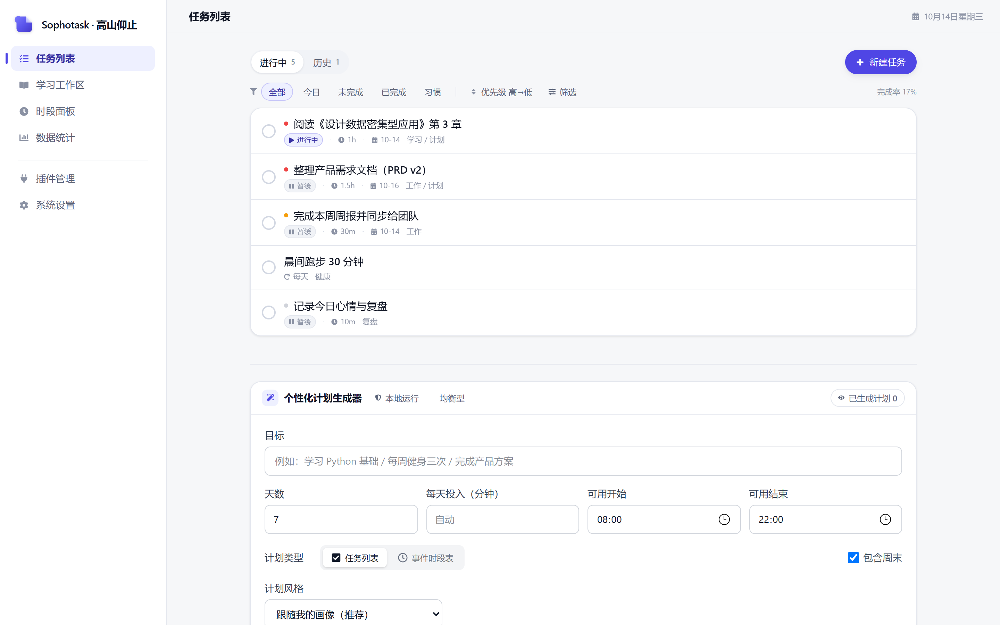
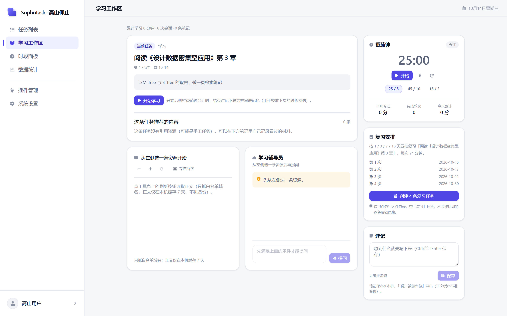
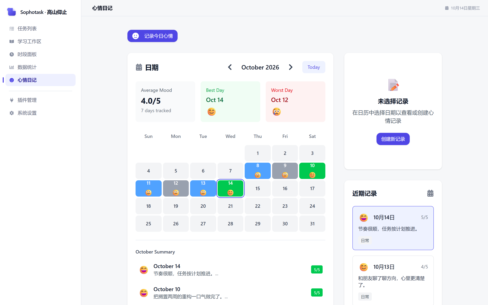
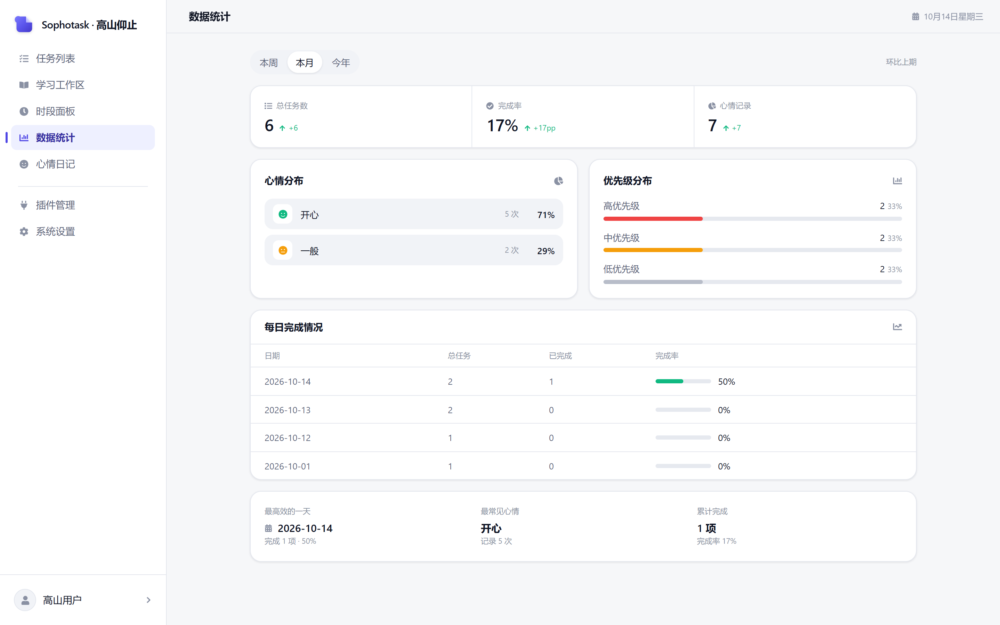
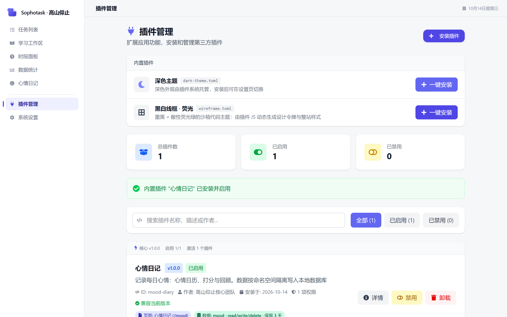
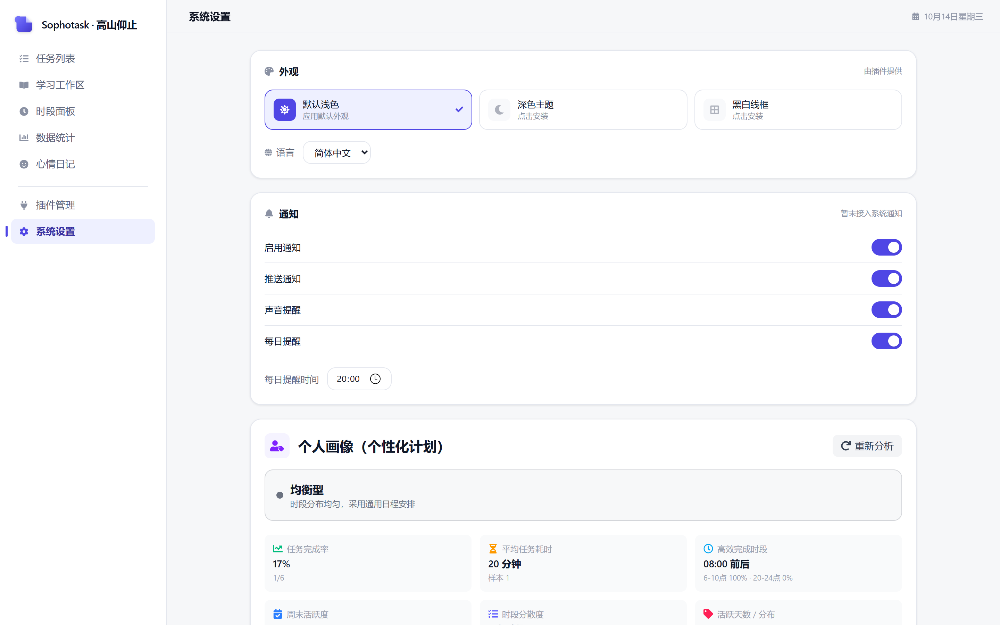

<div align="center">


# Sophotask · 高山仰止

**本地优先的桌面端「任务 · 心情 · 计划」一体化效率应用**

任务与习惯打卡 · 心情日记 · 时段面板 · 数据统计
外加**声明式插件宿主**、**个性化计划生成器（含 Agent 增强层）**，以及把计划真正落到执行的**学习工作区**。

[](https://github.com/yuyuyuyutt/sophotask/actions/workflows/ci.yml)
[](LICENSE)
[](CHANGELOG.md)
[](https://tauri.app/)
[](https://react.dev/)
[](https://www.typescriptlang.org/)

**全部数据留在本机。** 默认不联网；只有用户显式打开「资源与联网」中的联网层，才会发出检索请求。

</div>

---

## 界面预览

<p align="center">
  
  
</p>

<p align="center">
  
  
</p>

<p align="center">
  
  
</p>

---

## 功能特性

### 任务与习惯
- **任务 CRUD + 增量更新**：状态（暂缓 / 进行中 / 完成）在列表行上直接点击切换，乐观更新、失败回滚。
- **习惯打卡**：按天 / 工作日 / 周末 / 自定义周期，记录连续天数与完成率。
- **计划任务逐条解锁**：一份计划在列表里只占一行（“下一条待做”），完成一条才显示下一条，避免十几条待办同时压过来。
- **悬浮看详情**：鼠标停留（或键盘聚焦）浮现详情卡，展示目标 / 进度 / 建议时段 / 安排理由 / 方法论 / 引用资源。
- **时段面板**：独立数据域，把任务安排到「日期 × 时段」的二维格子中。

### 心情与统计
- **心情日记（插件化页面）**：日历视图、1–5 分打分、表情与标签，支持历史回顾。
- **数据统计**：与上一等长周期真实同比，完成率 / 心情分布 / 优先级分布 / 每日完成情况。

### 插件系统（本项目最有意思的部分）
- **声明式清单**：插件用 TOML 描述能力（`theme` / `page` / `data` / `code`），**清单本身不含可执行代码**。
- **沙箱隔离**：页面 / 代码类插件跑在 `iframe` 中，通过 `postMessage` 与宿主通信，并对消息来源做校验。
- **数据权限门**：插件只能读写自己声明过的 `namespace` / `collection`，越权操作一律抛错（每条拒绝分支都有单测）。
- **生命周期**：安装期校验 `minCoreVersion` / `maxCoreVersion`；卸载后数据进入保留期（回收站），期内重装自动恢复。
- **内置示例**：心情日记、深色主题、黑白线框·荧光 —— 都走同一条真实安装链路。

### 个性化计划生成器 + Agent 增强层
- **两条入口**：`开始 3 步生成`（用户逐步驱动）与 `Agent 一键生成`（确定性编排器调度四角色协作）。
- **多角色协作**：Clarifier / Researcher / Planner / Critic，角色间走 zod 校验的结构化消息，Critic 只产出违规清单与变更 diff。
- **四级降级**：`multi → single → pipeline → rule`，**任一层失败都会退到确定性路径**，绝不因模型不可用而卡住。
- **语义检索（RAG）**：本地 embedding + 向量落 SQLite（**余弦 Top-K 在 Rust 侧算，向量不过 IPC**），与启发式排序做 RRF 融合。
- **内容级证据**：白名单域名正文抓取 → 句子边界分块 → 只有最相关的证据块进 prompt，并以 `E1..En` 编号参与**引用白名单**校验。
- **可观测**：run 级轨迹（步骤 / 工具裁决理由 / 记忆命中 / 降级原因 / 耗时 / prompt 版本）在设置页可逐条展开。
- **可回归**：离线评测 harness（`npm run eval`，7 条脚本化用例 + 9 项指标 + 门禁，已接入 CI），跑的是生产同一套代码、只替换模型层。

### 学习工作区（`/study`）
- 聚焦**下一条待做** → 白名单**阅读模式**（只渲染纯文本 / 结构化 Markdown）→ 番茄钟 → 收工总结 → 间隔复习。
- **学习辅导员先检索再回答**：没有正文 / 检索不到片段 / embedding 不可用 / 未开模型都不调用模型。
- **数据回流**：把“预估 vs 实际”写进记忆，下次生成计划时用于校准每日投入。

### 数据与工程质量
- **双后端存储**：同一套前端代码跑在 Tauri 桌面端（SQLite + 文件系统）与浏览器（`localStorage`），判定统一走 `isTauriRuntime()`。
- **迁移机制**：`PRAGMA user_version` 驱动的顺序迁移，新库建表即最新结构，旧库逐版本升级，加字段不再需要用户清数据。
- **全量备份 / 恢复**：聚合 SQLite 任务、插件命名空间数据、IndexedDB 计划、应用设置、用户资料五类数据；恢复是**合并而非清库重建**。
- **质量门禁**：`typecheck` → `lint` → `test` → `eval` → `build`，GitHub Actions 全自动执行；版本号以 `tauri.conf.json` 为单一真源。

---

## 快速开始

```bash
npm install          # 安装前端依赖（首次还需 rust 工具链，见 docs/DEV-GUIDE.md）
npm run dev          # 仅前端：Vite dev server（http://localhost:1420，strictPort）
npm run tauri dev    # 完整桌面应用（前端 dev server + Rust 后端 + SQLite）

npm run build        # 类型检查 + 前端产物到 dist/
npm run tauri build  # 打包桌面安装包
npm test             # 单元测试（vitest run）
```

| 命令 | 作用 | 说明 |
|---|---|---|
| `npm run dev` | 前端热更新 | 浏览器里跑时，存储自动降级为 `localStorage`（无 SQLite） |
| `npm run tauri dev` | 桌面开发 | 唯一能体验 SQLite、文件系统、真实插件落盘的入口 |
| `npm run build` | `tsc && vite build` | 任何类型错误都会中断构建（`strict` + `noUnusedLocals`） |
| `npm run tauri build` | 出安装包 | 依赖 `src-tauri/capabilities/default.json` 的权限声明 |
| `npm run typecheck` | `tsc --noEmit` | 只做类型检查，不产出文件（CI 用这个） |
| `npm test` | `vitest run` | 覆盖计划生成器 + api 映射 + 插件数据权限门 + 版本比较 + 备份校验 |
| `npm run eval` | 离线评测 | 7 条脚本化用例 + 9 项指标门禁（不联网、不需要本地模型） |
| `npm run version:check` | 校验版本号 | 真源是 `src-tauri/tauri.conf.json`；`npm run version:sync` 一键同步另两处 |

> Rust 侧没有放进 CI（需要系统级 WebKitGTK 依赖），本地请跑：
> `cd src-tauri && cargo check --message-format=short`。

---

## 顶层结构

```
sophotask/
├─ src/                    # 前端源码（React + TS），详见 docs/ARCHITECTURE.md
│  ├─ api/                 # 数据访问层：任务 CRUD（唯一碰 SQLite 的地方）/ 时段面板
│  ├─ components/          # 通用组件（布局、任务、心情、插件）
│  ├─ pages/               # 5 个内置页面（路由终点）
│  ├─ plugins/             # 插件系统：parser（清单解析）/ runtime（宿主）/ builtin / pages
│  ├─ features/plan-generator/  # 个性化计划生成器 + Agent 增强层（services/{llm,agent,memory,rag}，自带 README 与测试）
│  ├─ hooks/ · utils/ · types/
├─ src-tauri/              # Rust 后端：SQLite、向量检索、正文代理、命令、权限
│  ├─ src/lib.rs           # ← 应用唯一入口（模块、插件挂载、全部命令注册、run()）
│  ├─ src/main.rs          # 4 行薄封装：调用 sophotask::run()
│  ├─ src/commands.rs      # 全部 #[tauri::command]（任务 / 插件数据 / 检索 / 向量 / 正文抓取）
│  ├─ src/database.rs      # 连接池 + 建表 + user_version 顺序迁移 + 行映射
│  ├─ src/embeddings.rs    # 向量内核：f32 BLOB 序列化、归一化、余弦 Top-K（纯函数 + 单测）
│  ├─ src/content.rs       # 正文内核：HTML→文本 / Markdown、标题提取、SSRF 防护（纯函数 + 单测）
│  ├─ src/http.rs          # 出站 HTTP（JSON / 文本），全局复用连接池
│  └─ capabilities/default.json  # Tauri 2 ACL 权限声明
├─ public/                 # 静态资源（logo 等）
├─ scripts/                # sync-version.mjs（版本号唯一真源同步）
├─ docs/                   # 维护与开发文档（见下表）+ 界面截图
├─ .github/workflows/ci.yml  # CI：版本校验 → 类型 → Lint → 单测 → 评测 → 构建
├─ CHANGELOG.md            # 更新日志
└─ LICENSE                 # MIT
```

---

## 文档索引

| 文档 | 什么时候看 | 内容 |
|---|---|---|
| [docs/ARCHITECTURE.md](docs/ARCHITECTURE.md) | 第一次接触代码 / 想加一个页面 | 分层结构、启动时序、插件宿主内部机制、目录职责速查 |
| [docs/DATA-MODEL.md](docs/DATA-MODEL.md) | 改数据库、加字段、排查“数据去哪了” | SQLite 表结构、IndexedDB、localStorage、AppData 文件、四层存储全景 |
| [docs/IPC-API.md](docs/IPC-API.md) | 加 / 改一个前后端命令 | 全部命令契约、参数命名规则、返回结构、错误约定 |
| [docs/PLUGIN-GUIDE.md](docs/PLUGIN-GUIDE.md) | 写插件 / 改内置插件 | 清单字段、四类能力、校验规则、沙箱协议、可直接抄的模板 |
| [docs/DEV-GUIDE.md](docs/DEV-GUIDE.md) | 日常开发、调试、踩坑 | 环境准备、调试手法、本机 Windows 特有的坑、代码规范 |
| [docs/AI-OPTIMIZATION.md](docs/AI-OPTIMIZATION.md) | 做 AI / 检索 / 提示词优化 | RAG / Prompt Engineering / Tool Calling 的细粒度清单与落点 |
| [docs/AGENT-ARCHITECTURE.md](docs/AGENT-ARCHITECTURE.md) | Agent 化改造 | Agent Runtime 目标架构（RAG · Skill · Multi-Agent · Memory）、分阶段实施计划、进度追踪表 |
| [docs/STUDY-WORKSPACE.md](docs/STUDY-WORKSPACE.md) | 学习工作区（`/study`） | 为什么长这样、复用落点、三个产品决定、分期与“明确不做” |
| [docs/TODO.md](docs/TODO.md) | 排期 / 接手前先读 | 技术债清单、已知缺陷、建议的下一步 |
| [CHANGELOG.md](CHANGELOG.md) | 看版本演进 | 各版本的能力、修复与工程改动 |

---

## 五个必须先理解的设计决策

**1. 双后端存储。** 同一套前端代码跑在两种环境：Tauri 桌面端（SQLite + 文件系统）与浏览器
（`localStorage`）。判定统一走 `src/utils/runtime.ts` 的 `isTauriRuntime()`。
**凡是新增持久化代码，都要同时给出两种实现**，否则浏览器开发模式下会静默失效。

**2. 插件是“声明式”的。** 插件清单（TOML）不携带可执行代码，宿主按清单解释执行四类能力：
`theme`（主题）、`page`（页面）、`data`（命名空间数据）、`code`（沙箱 JS）。因此插件天然不能
触碰主应用 DOM，能力边界由宿主代码定义，而不是靠“信任插件作者”。详见 PLUGIN-GUIDE。

**3. 页面路由由插件参与生成。** 内置 5 个页面是硬编码路由；插件贡献的页面通过
`usePluginRoutes()` 在 `<Routes>` 内展开。**“心情日记”页面本身就是插件化的**——它作为
内置插件 `mood-diary` 存在，卸载它 `/mood` 路由与导航项一起消失。

**4. AI 能力是“可降级的一层”，不是主线依赖。** 计划生成有两条入口：
`开始 3 步生成`（用户逐步驱动）与 `Agent 一键生成`（确定性编排器驱动四角色协作）。
两者共享底层能力，且**任一层失败都会退到确定性路径**（模板问题 → 规则关键词 → 规则生成器 → 本地指令解析）。
设计总纲与进度表见 [`docs/AGENT-ARCHITECTURE.md`](docs/AGENT-ARCHITECTURE.md)。

**5. 执行侧也有闭环。**「学习工作区」（`/study`）负责**执行**计划：聚焦下一条任务 → 白名单阅读模式
→ 番茄钟与收工总结 → 间隔复习；辅导员**先检索再回答**（没有依据就不调模型），学习会话把
“预估 vs 实际”回流成记忆供下次生成计划校准。方案与决策记录见
[`docs/STUDY-WORKSPACE.md`](docs/STUDY-WORKSPACE.md)。

---

## 质量基线（2026-09-28 实测）

| 检查 | 命令 | 结果 |
|---|---|---|
| 类型检查 | `npm run typecheck` | ✅ 0 error |
| Lint | `npm run lint` | ✅ 0 error / 24 warning（存量 `any` 与 hooks 依赖告警） |
| 单元测试 | `npm test` | ✅ 38 个文件 / 394 个用例全部通过，约 2s |
| 离线评测 | `npm run eval` | ✅ 7 条脚本化用例全通过，9 项指标全部达门禁 |
| 生产构建 | `npm run build` | ✅ `tsc && vite build` 通过 |
| 版本号一致性 | `npm run version:check` | ✅ 三处均为 0.1.3 |
| Rust | `cd src-tauri && cargo check` | ✅ 0 error / 0 warning |
| Rust 单测 | `cd src-tauri && cargo test --lib` | ✅ 23 个用例通过（向量 + 正文清洗 / Markdown 转换 / SSRF + 更名目录迁移） |
| CI | `.github/workflows/ci.yml` | 上述检查在 push / PR 上自动执行 |

2026-09-28 起新增的 257 个用例集中在 Agent 增强层的**安全边界与降级路径**：
白名单 / 权限 / 参数校验 / 确认令牌 / 记忆召回闸门 / 变更 diff 正确性 /
embedding 缓存与接口兼容 / RRF 融合与语义检索降级 / 正文分块与提示注入隔离 /
多角色消息契约与 Critic 校验 / 离线评测器口径 / 计划队列与详情解析 /
学习工作区（数据域、阅读闸门、Markdown 渲染、番茄钟、间隔复习、辅导员检索与拒绝路径、流式传输）。

**尚未建立**：Prettier（格式交给编辑器）、E2E / 交互型组件测试（当前只有 SSR 渲染冒烟 `*.test.tsx`）、覆盖率统计。

---

## 更新日志

各版本的完整改动见 [CHANGELOG.md](CHANGELOG.md)。当前版本 **0.1.3**，工作区还包含尚未发布的
Agent 增强层与学习工作区（见 [docs/AGENT-ARCHITECTURE.md](docs/AGENT-ARCHITECTURE.md)）。

---

## 许可

本项目基于 [MIT License](LICENSE) 开源。
