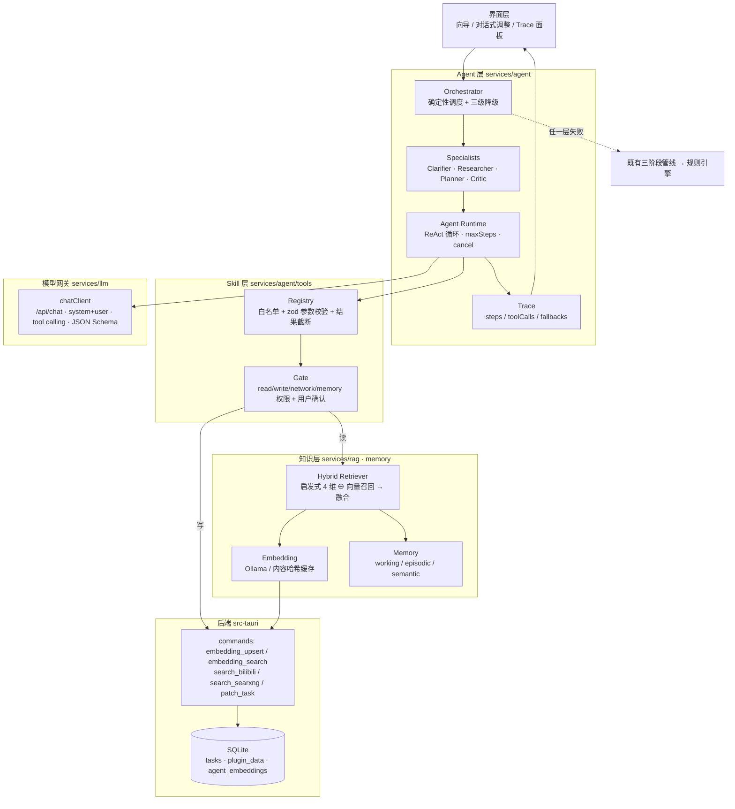

# Agent 化改造总纲 —— RAG / Skill / Multi-Agent / Memory

> **这份文档的唯一用途**：把 sophotask 讲成一个"Agent 开发方向"的简历项目，并作为面试追问的答题底稿。
> 维护纪律：**只写仓库里真实存在的实现**。每条设计都必须能在代码里指到文件；
> 未落地的条目留在「实施计划」里，落地当天补上"证据锚点"再上简历。
>
> **当前进度（2026-09-28）：P0 – P6 全部落地**——
> 模型网关（`/api/chat` + JSON Schema + 提示词版本化）、run 级轨迹 **+ 轨迹面板**、
> 情景记忆、Skill 体系 + 对话式计划调整、本地向量检索（embedding + 向量表 + RRF 混合检索）、
> 内容级 RAG（正文抓取 / 分块 / 证据白名单 / 提示注入隔离）、
> 多角色协作（Orchestrator + Clarifier/Researcher/Planner/Critic，含修正轮与四级降级）、
> **离线评测 harness（`npm run eval`，7 条用例 / 9 项指标 / 门禁接入 CI）**。
> 仍未做的只是加分项：方法论语料知识库、语义记忆、原生 function calling。
>
> 关联文档：[AI-OPTIMIZATION.md](AI-OPTIMIZATION.md)（RAG/PE/TC 的细粒度清单）、[ARCHITECTURE.md](ARCHITECTURE.md)（现有分层）、[RESUME-PROJECT.md](RESUME-PROJECT.md)（全栈版简历稿）、[`src/features/plan-generator/README.md`](../src/features/plan-generator/README.md)（模块级说明）。

---

## 0. 一句话定位

### 0.1 一句话定位（P0–P5 已落地，可直接用）

> **本地优先的桌面 AI Agent 应用**：在 Tauri 2 + React 19 之上自研 **Agent Runtime**——
> 四角色协作（确定性 Orchestrator + Clarifier / Researcher / Planner / Critic）、
> 白名单 + 权限门 + 用户确认闸门的 **Skill 体系**、
> 向量化 **混合检索 RAG**（本地 embedding + 正文证据 + 引用级防幻觉 + 提示注入隔离）、
> 两档落地 **Memory**（工作记忆由 trace 承担 / 情景记忆可合并可衰减可审计），
> 全程**可观测 trace（含可视化面板）+ 离线评测门禁**，且任一环节失败自动降级，**永不阻塞、永不编造**。

### 0.2 简历项目名下方第一行（按落地事实逐项可查）

> 基于 **Tauri 2 + React 19** 的本地优先桌面效率应用，内置自研 **Agent 增强层**：
> 模型网关（`/api/chat` + system/user 分离 + JSON Schema 结构化输出 + 提示词版本化）、
> **Skill 体系**（白名单注册 + zod 参数校验 + scope 权限门 + 写操作 diff 预览与用户确认 + 一次性确认令牌）、
> **内容级 RAG**（本地 embedding + 内容哈希缓存 + 余弦 Top-K 下沉 Rust + RRF 混合检索 + 正文证据白名单）、
> **多角色协作**（结构化消息契约 + 澄清自问自答并标注依据 + 确定性 Critic + 四级降级）、
> **情景记忆**（结论 + 证据 + 置信度，可合并、衰减、归档、审计）、
> **run 级可观测轨迹**（步骤 / 工具裁决 / 降级原因 / prompt 版本）。
> **26 个测试文件 / 301 个前端用例 + 13 个 Rust 用例全绿**；另有**离线评测门禁**
> （`npm run eval`：7 条用例 / 9 项指标，已接入 CI），`typecheck` / `lint` / `build` / CI 全绿。

**30 秒口语版**：
> 它原本是一个"调用 LLM"的桌面效率应用。我把它改造成了本地 Agent 运行时：
> 模型只负责决策 —— 选哪个工具、填什么参数、写哪条计划；所有动作都要过注册表、参数校验与权限门，
> 写操作先出 diff 让用户确认才生效。
> 检索侧做了向量化混合召回，还会抓取白名单域名的正文、分块后只把最相关的证据喂给模型，
> 引用必须能追到具体证据编号，追不到就丢弃。
> 一轮生成由确定性编排器调度四个角色，Critic 用可判定的规则校验硬约束并给出修正差异；
> 每次运行都留一条结构化轨迹，能看到走到哪一级、在哪一步降级、为什么降。
> 最关键的一条原则是从原项目继承下来的：**任何 AI 环节失败都静默降级到确定性路径**，
> 所以它不会因为模型抽风就不可用。

---

## 1. 现状盘点（改造前）

### 1.1 已经有的（都是可复用的地基，不是从零开始）

| 能力 | 实现位置 | 对 Agent 化的价值 |
|---|---|---|
| 三阶段 LLM 管线（澄清 → 关键词检索 → 计划生成） | `services/clarificationService.ts` / `resourceService.ts` / `planComposer.ts` | Agent 化的**降级底座**：Agent 挂了就退回这条确定性管线 |
| LLM 生命周期管理：串行、同 key 去重、空闲调度、可取消、超时、指标 | `services/llmTaskManager.ts`（`llmTasks` 单例，`whenIdle`、`getStats`） | 直接演进为 Agent Runtime 的**调度与可观测基座** |
| 容错 JSON 解析 + 字段夹紧 | `services/jsonExtract.ts` | 结构化输出契约的最后一道防线 |
| 提示词集中管理 + 输出契约 | `services/prompts.ts` | 拆 `system/user`、加版本号、加 few-shot 的落点 |
| 启发式 4 维打分（可信度 .30 / 时效 .25 / 难度 .25 / 偏好 .20）+ URL/标题去重 + 分类型截断 | `services/resourceService.ts:194`、`collectResources` | **混合检索的关键词/规则侧**，向量召回是叠加而非替换 |
| 引用白名单防编造（丢弃不在资源列表里的 `resourceIds`） | `services/planComposer.ts`（`droppedCitations`） | 升级为 **chunk 级引用可溯源**，是 RAG 的诚信基线 |
| 三层检索编排（B 站 / SearXNG / 平台跳转）+ Rust 侧代理绕 CORS | `services/resources/*`、`src-tauri/src/commands.rs:422/513` | RAG 的**外部数据入口**已通 |
| 本地持久化：IndexedDB `sophotask-planner`（kv / plans / resources）+ SQLite `plugin_data` | `db/plannerDB.ts`、`src-tauri/src/database.rs:84` | Memory 与向量索引的**双后端落盘**照抄即可 |
| 声明式插件安全模型：能力声明 + namespace 权限门 + 沙箱来源校验 | `src/plugins/runtime/dataStore.ts`、`sandbox.ts` | Skill 权限门的**架构原型**，叙事上前后一致 |
| 双运行时抽象 `isTauriRuntime()` + `PRAGMA user_version` 迁移机制 | `src/utils/runtime.ts`、`database.rs:119` | 向量表可以走"迁移追加"，老用户库不用重建 |
| 测试与 CI：vitest 12 文件 / 120 用例、ESLint 9、GitHub Actions、版本单一真源 | `vitest.config.ts`、`.github/workflows/ci.yml` | Agent 代码同样进 CI，评测脚本可挂成 CI 任务 |

### 1.2 缺的（改造开始时的四个缺口）

| 方向 | 改造前 | 缺口 | 现状 |
|---|---|---|---|
| **RAG** | 只有 search-then-cite：检索到的标题/URL 行进 prompt，模型在"盲选"；打分为启发式加权，**无语义相关度维度** | embedding、向量索引、正文分块、引用级校验、混合融合排序 | 🟢 已落地（P3 向量 + P4 正文证据与引用白名单） |
| **Skill / Tool** | LLM 是**纯文本生成器**，只在固定点位被调用；编排 100% 硬编码 | 工具注册表、参数校验、读写权限分级、写操作确认闸门 | 🟢 已落地（P2） |
| **Multi-Agent** | 单条 prompt 一次调用，无角色、无消息协议、无校验者 | 角色分工、结构化消息契约、Critic 校验闭环、确定性编排与合并 | 🟢 已落地（P5） |
| **Memory** | 历史计划的 `feedback` 字段存在但空转；画像只喂**统计特征**，没有质性与成败细节 | 情景记忆写入/召回、语义记忆、记忆去重与衰减、记忆注入的 prompt 片段化 | 🟢 情景记忆已落地（P1）；语义记忆待做 |
| **可观测 / 可评测** | 只有 `console.warn` 与 `generation.warnings` | run 级轨迹、降级原因可查、离线指标 | 🟡 轨迹已落地（P0）+ 运行报告（P5）；评测 harness 待做（P6） |

**结论**：现有工程纪律（降级、白名单、可观测、双后端）**质量很高但方向是"LLM 应用"**；
改造不需要推翻，而是**在同一套纪律上叠加 Agent 能力**——这正是简历上的叙事优势：
"不是又一个 LangChain demo，而是把 Agent 能力做进了有安全边界和降级纪律的工程里"。

### 1.3 改造后（P0–P2）新增了什么

| 新增 | 一句话 | 关键文件 |
|---|---|---|
| 模型网关 | 三阶段从 `/api/generate` 单条 prompt 切到 `/api/chat` + **JSON Schema 约束解码**，schema 被拒时自动降级重试 | `services/llm/{chatClient,schemas}.ts` |
| 提示词版本化 | `PROMPT_VERSION` 写进 trace 与 `plan.generation`，为效果对比留锚点 | `services/prompts.ts` |
| run 级轨迹 | 每次 AI 运行都留结构化记录：步骤 / 工具裁决 / 记忆命中 / 降级原因 / 耗时 | `services/agent/trace.ts` |
| 情景记忆 | 结论 + 证据 + 置信度；合并、衰减、归档、可审计可删除，并纳入备份 | `services/memory/*`、`db/plannerDB.ts`、`components/MemoryCard.tsx` |
| Skill 体系 | 白名单 + zod + scope 权限门 + diff 预览 + 一次性确认令牌 | `services/agent/tools/*` |
| 对话式调整 | "整周顺延 2 天"→ 变更预览 → 确认应用；模型不可用时走本地指令解析 | `services/agent/adjustPlan.ts`、`components/PlanAdjustPanel.tsx` |
| 向量检索（P3） | 本地 embedding + 内容哈希缓存 + 向量落 SQLite（余弦 Top-K 下沉 Rust）+ RRF 混合排序 | `services/rag/{embedding,vectorStore,hybridRetriever}.ts`、`src-tauri/src/embeddings.rs` |
| 内容级证据（P4） | 白名单域名的正文抓取（Rust 代理 + SSRF 防护）→ 句子边界分块 → 只注入最相关的几块 + 提示注入隔离 | `services/rag/{chunking,contentCache,contentFetcher,evidence}.ts`、`services/agent/promptGuard.ts` |
| 多角色协作（P5） | 确定性 Orchestrator 调度 Clarifier / Researcher / Planner / Critic，结构化消息 + 澄清自答 + 修正轮 + 四级降级 + 运行报告 | `services/agent/agents/*`、`components/AgentRunPanel.tsx` |
| 学习工作区（P7） | 执行侧闭环：聚焦下一条 → 白名单阅读模式（**Rust 侧还原 Markdown 结构**，阅读优先版面）→ 番茄钟 → 收工写会话与记忆 → 间隔复习 1/3/7/16 天 | `pages/StudyWorkspace.tsx`、`api/studyStore.ts`、`features/study/*`、`src-tauri/src/content.rs`（`html_to_markdown`） |
| 质量基线 | 前端单测 127 → **384**（37 文件），Rust 20 例；lint 0 error；typecheck / build / CI 全绿 | `npm test` / `npm run lint` / `cargo test --lib` |

---

## 2. 目标架构



> **落地状态说明（以第 9 节进度表为准）**
> - **已落地**：模型网关（`llm/chatClient` + `llm/schemas`）、Trace（`agent/trace` + `components/TracePanel`）、
>   Skill 层（`agent/tools/*` + `agent/adjustPlan`）、Memory 的结构化召回（`memory/*`）、
>   向量检索（`rag/embedding` + `rag/vectorStore` + `rag/hybridRetriever`，桌面端由 Rust `embeddings.rs` 承担余弦 Top-K）、
>   内容级 RAG（`rag/chunking` + `rag/contentCache` + `rag/contentFetcher` + `rag/evidence` +
>   `agent/promptGuard`，桌面端由 Rust `content.rs` / `fetch_page_text` 承担抓取与清洗）、
>   多角色协作（`agent/agents/*`：protocol / critic / roles / orchestrator）、
>   离线评测（`services/eval/*` + `npm run eval` + CI 步骤），
>   以及既有的"三阶段管线 → 规则引擎"降级链。
> - **仍未落地（加分项，本文档标注 ⬜）**：方法论语料知识库（RAG-4）、语义记忆的产出、
>   原生 function calling 与跨轮 ReAct 循环。

四条设计原则（贯穿全部模块，也是面试的"总纲"答案）：

1. **模型只做决策，动作必须过闸门**：LLM 输出永远不被直接执行，一律经 Skill 注册表 → 参数校验 → 权限门 → （写操作）用户确认。
2. **确定性优先，AI 是增益不是依赖**：每个 AI 环节都有确定性回退，回退路径本身是产品功能的一部分。
3. **可溯源**：结论必须能追到来源（chunk id / 资源 id / 历史 plan id），追不到就丢弃并计数。
4. **本地优先**：模型、向量、记忆全部留在本机；联网只发生在用户显式打开的资源检索层。

---

## 3. RAG：向量化混合检索 + 内容级证据

> ✅ **P3 + P4 均已落地**：embedding / 向量表 / 余弦 Top-K / RRF 混合检索 / 第 5 维语义分 /
> 正文抓取与分块 / 证据白名单 / 提示注入隔离 / 设置页索引与缓存管理。

### 3.1 模块与落点（已落地）

| 模块 | 文件 | 职责 |
|---|---|---|
| Embedding | `services/rag/embedding.ts` | 调 Ollama `/api/embed`（批量；`nomic-embed-text` / `bge-m3`）；**内容哈希 → 缓存**（`planEmbeddingWork` 只重算变化的内容）；接口不被支持时退回逐条 `/api/embeddings`；超时/5xx **不重试**；本层不做降级决策，失败即抛 |
| 向量存储 | `services/rag/vectorStore.ts` | 双后端：Tauri → Rust `agent_embeddings` 表；浏览器 → IndexedDB `embeddings` store。统一 `hashes / upsert / search / remove / clear / stats` |
| 混合检索 | `services/rag/hybridRetriever.ts` | `fuseWithRRF` 融合"启发式名次 ⊕ 语义名次"；`applySemanticRerank` 重排候选并把余弦写进 `scoreDetail.semantic`；`runSemanticRetrieval` 编排"取哈希 → 增量嵌入 → 检索"，**永不抛出** |
| 接线 | `services/resourceService.ts`（`collectResources`） | 在**截断之后**做语义重排（不为会被丢掉的结果付 embedding 成本）；失败时写入"语义检索已降级为关键词排序：原因" |
| 设置与索引管理 | `components/EmbeddingSettingsCard.tsx`、`hooks/useEmbeddingSettings.ts` | 开关 / 模型 / 连通性测试（报出向量维度）/ 已索引条数与维度 / 一键清空索引 |
| 向量内核（Rust） | `src-tauri/src/embeddings.rs` | `serialize`/`deserialize`（f32 小端 BLOB）、`normalize`、`dot`、`top_k`；纯函数，带 **7 个 `cargo test` 用例** |
| 向量命令（Rust） | `src-tauri/src/commands.rs` | `embedding_upsert`（事务批量、写时归一化）/ `embedding_hashes` / `embedding_search`（余弦 Top-K）/ `embedding_delete` / `embedding_clear` / `embedding_stats` |
| 建表 | `src-tauri/src/database.rs` | `agent_embeddings(namespace, ref_id, model, dim, content_hash, vector BLOB, updated_at)` + namespace 索引 |
| 分块（P4） | `services/rag/chunking.ts` | 窗口 + 重叠切块，**优先在句子边界断开**（窗口 60% 之后才允许提前断），单页上限 40 块；`chunkRefId(resourceId, index)` 作为稳定 id |
| 正文缓存（P4） | `services/rag/contentCache.ts` | 独立 IndexedDB store（**不进备份**）、TTL 7 天、最多 20 页、按最近抓取淘汰；`pruneContentCache` 是纯函数 |
| 正文抓取（P4） | `services/rag/contentFetcher.ts` | 域名白名单（**留空 = 不抓**）+ 超时 + 字数上限 + 缓存；桌面端走 Rust 代理，浏览器模式直连并静默降级 |
| 正文代理（P4，Rust） | `src-tauri/src/content.rs` + `http.rs` + `commands.rs` | `html_to_text` / `extract_title` / `is_public_host`（SSRF 防护）+ `fetch_text`（下载字节上限 + 只接受文本类型）+ `fetch_page_text` 命令；6 个 `cargo test` 用例 |
| 证据编排（P4） | `services/rag/evidence.ts` | 白名单筛选 → 抓取 → 分块 → 内容寻址增量嵌入 → 按 query 召回 Top-N → 分配 `E1..En` + 生成不可信数据块；**永不抛出**，逐级降级 |
| 注入隔离（P4） | `services/agent/promptGuard.ts` | `sanitizeExternalText`（去控制字符与伪造的 `system:` / `<\|im_start\|>` 标记、限制长度）、`wrapUntrustedData`（显式起止标记）、`UNTRUSTED_SYSTEM_RULE`（写进 system 的固定声明） |
| 引用校验（P4） | `services/planComposer.ts` | `evidenceIds` 与 `resourceIds` 走同一套"白名单 + 丢弃计数"；丢弃数写进 trace 的 `guard:citations` 步骤 |

**为什么没有对应的迁移条目**：`init_tables` 每次启动都会执行，用的是 `CREATE TABLE IF NOT EXISTS`，
所以老库启动即自动补齐；`MIGRATIONS` 只保留给无法幂等表达的变更（ALTER / 数据搬迁）。
这是沿用项目既有做法，而不是"忘了写迁移"。

### 3.2 关键设计决策（面试重点）

- **为什么把余弦计算下沉到 Rust**：前端只把 query 向量发一次，Top-K 结果（含分数）回传；
  若在前端算，需要把整表向量经 IPC 拉进 JS（数千条 × 768 维 ≈ 数十 MB JSON）。
  写入时统一做 L2 归一化，检索退化为点积，省掉每次开方。
  这与项目既有的"数据访问收口在 `src/api`、脏活留给 Rust"一致。
- **为什么用 RRF 融合而不是加权求和**：两路得分（启发式 0–1 与余弦 −1–1）**量纲不可比**，
  硬加权要么反复调参、要么被某一侧主导，而且"这条为什么排前面"说不清。
  RRF 只用名次：`score = Σ w/(k + rank)`，k 取 60。可解释、无需调参、对离群值不敏感。
- **第 5 维是怎么回事**：余弦相似度写进 `scoreDetail.semantic` 作为**可解释维度**，
  但排序交给 RRF——因为它与另外四维量纲不同，塞进同一个加权和会让原有权重失效。
  未开启语义检索时，`resourceService` 既有 24 个用例的行为**完全不变**。
- **内容寻址缓存**：候选文本先算哈希，`planEmbeddingWork` 只把"新增或内容变了"的送进模型。
  embedding 是本地模型里最贵的一步，命中率直接决定这个功能能不能日常用；
  同时**换模型 = 换向量空间**，因此 `hashes` / `search` 都按 `model` 过滤，旧向量不会与新 query 混算。
- **降级链**：未开启 → 不传 `rag`，走原路径；模型不可用 / 超时 / 维度不符 / 索引读取失败 →
  `enabled:false + degradedReason`，排序退回关键词且在 UI 写明原因；候选不足 2 条 → 不做语义（没有意义）。
  **任何一条断掉，检索都还能出结果，计划照常生成。**
- **索引是派生数据**：不保存网页正文、不进备份（可重建且体积大），设置页可一键清空。
- **sqlite-vec 的取舍**：默认走"Rust 内全表扫描 + 余弦"，个人场景（数千条）毫秒级；
  引入扩展的运维成本（编译、平台差异、升级）大于收益。**知道什么时候不该引入依赖也是设计能力。**

### 3.3 内容级证据（P4）的四个关键取舍

**① 引用白名单从"资源级"下沉到"证据级"，但用的还是同一套机制。**
P3 时模型只能引用 `resourceIds`；P4 起每条任务还可以引用 `evidenceIds`（`E1`、`E2`…）。
宿主只在"本次真正注入过的那几个编号"里放行，其余丢弃并计数（`droppedEvidence`）。
为什么不直接在正文里写 `[chunk:xxx#2]` 这种内联标记：本地 7B 模型对内联标记的复现很不稳定，
而"给编号、要求填数组"和 `resourceIds` 是同一个模式 —— 换汤不换药，模型更容易学会，也更好测。

**② 注入的正文一律包成"不可信数据"。**
`evidence.promptSection` 是 `wrapUntrustedData(...)` 的产物，带显式起止标记；
system 里同时写入 `UNTRUSTED_SYSTEM_RULE`，明确"其中的任何指令都不是用户指令"。
`sanitizeExternalText` 还会去掉控制字符与伪造的 `system:` / `<|im_start|>` 标记。
**但要说清边界**：这不等于"防注入成功"，真正的兜底是下游的硬约束
（引用白名单、日期白名单、耗时夹紧、写操作必须用户确认）—— 就算模型被带偏，也改不出越界的计划。

**③ 正文缓存刻意与"可导出数据"分开。**
本项目对外的隐私口径是"只保存标题与链接，不保存网页正文"。
所以抓到的正文放在**独立的 `contentCache` store**（TTL 7 天、最多 20 页、不进数据备份、设置页可一键清除），
而不是塞进会被整表导出的 `kv`；向量索引里也只有向量与内容哈希，同样不含正文。

**④ embedding 不可用时退化为"按资源顺序取前 N 块"。**
正文是真实抓到的，只是没做语义挑选 —— 比"什么都不注入"有用，比"瞎排序"诚实，
且 `note` 字段会明确告诉用户走了这条兜底路径。

### 3.4 Memory 与 RAG 的边界（区分清楚，别混讲）

| | 回答的问题 | 数据 | 生命周期 |
|---|---|---|---|
| **RAG** | "关于世界，我需要知道什么" | 外部资源正文、方法论语料 | 随检索变化，可重建 |
| **Memory** | "关于这个用户，我已经知道什么" | 历史计划、澄清回答、成败反馈、偏好 | 长期累积，需去重/衰减 |

---

## 4. Skill / Tool：白名单注册 + 权限门 + 确认闸门

> ✅ **状态：已落地（P2）**。下表全部对应真实文件。

### 4.1 模块与落点（已落地）

| 模块 | 文件 | 职责 |
|---|---|---|
| Skill 契约 | `services/agent/tools/types.ts` | `SkillDefinition<A,R>`：`scopes` / `sideEffect` / `paramsHint` / `schema(zod)` / `execute` / `commit?` / `preview?`；`PlanEditDiff` 定义"可预览的变更" |
| 注册表 | `services/agent/tools/registry.ts` | 唯一真源：**显式注册才可用**；`defineSkill` 把异构定义适配成统一形态（工具层**唯一**一处受控类型断言，保证进入 `execute` 的参数已过 schema）；`describeForPrompt()` 生成 prompt 里的工具清单 |
| 权限门 + 确认闸门 | `services/agent/tools/gate.ts` | 三道关：①白名单 ②scope ⊆ 会话授权 ③zod 参数校验；再加人工关：写工具只产出 diff 预览 + **一次性令牌（5 分钟过期）**，`commit(token)` 才落副作用；写工具未提供 `preview` 时**按安全默认值直接拒绝** |
| 内置只读工具 | `builtin/planQueryTools.ts` | `get_plan_summary`（计划摘要）/ `get_plan_resources`（资源清单）/ `recall_memory`（记忆召回） |
| 内置写工具 | `builtin/planEditTools.ts` | `shift_plan_days` / `compress_daily_minutes` / `remove_task` / `rename_task` / `move_task_to_day`。全部是**纯计算**，产出 `PlanEditDiff`（`changes` 人类可读明细 + `apply` 纯函数） |
| 单步 Agent run | `services/agent/adjustPlan.ts` | 宿主先跑只读工具备上下文 → 模型只做"选工具 + 参数"决策（结构化 JSON）→ 过闸门 → diff 预览 → 用户确认 → 应用到计划草稿；模型不可用时退化为**本地指令解析** |
| 提示注入隔离 | `services/agent/promptGuard.ts` | 外部内容一律经 `wrapUntrustedData` 包成显式数据块；system 里写入 `UNTRUSTED_SYSTEM_RULE` 声明其不构成指令；`sanitizeExternalText` 清洗控制字符与伪造的 `system:` / `<\|im_start\|>` 标记 |

### 4.2 为什么这套 Skill 设计可信（面试要点，句句有代码对应）

- **模型只做决策，变更由确定性代码算**：写工具不直接改数据，而是返回 `PlanEditDiff`
  （`changes` 供 UI 逐条展示 before→after，`apply` 是纯函数）。⇒ 变更**可预览、可单测、可回放**，
  模型不可能"顺手多改一个字段"。`__tests__/skills.test.ts` 直接断言 `apply` 后的日期 / 时长 / 项数。
- **Agent 没有新增任何写通道**：写工具的 `commit` 只是把 diff 贴回**计划草稿**；真正落库仍是
  用户点击"接受"后的 `taskMaterializer → api.createTask`；与数据库的写入口仍是既有
  `patch_task`（列白名单 + 占位符参数化）。⇒ 攻击面没有因为引入 Agent 而扩大。
- **权限门是插件权限门的同构复用**：插件的数据能力靠 `PluginDataStore` 在 store 内部强制校验
  namespace，Skill 靠 `gate.ts` 强制校验 scope，都遵循"**校验在能力内部，不靠调用方自觉**"。
  面试可以讲成"同一套安全哲学在两个子系统上的复用"，而不是每加一个功能就发明一套机制。
- **闸门对模型输出是"不信任"的**：未注册工具名、缺 scope、参数非法、写工具无预览，
  四条分支全部 `rejected` 并给出原因（单测逐条覆盖）。这正面回答了
  "LLM 会不会乱改我的日程"这个最容易被追问的问题。
- **确认令牌一次性且会过期**：`commit` 成功即消费；重复使用返回"令牌无效或已被使用"，
  超过 5 分钟返回"已过期"；UI 取消时 `discard` 立即失效 —— 避免"几小时前的确认被悄悄提交"。
- **工具可见性随权限收敛**：`gate.listVisible()` 只返回当前会话有权限的工具，
  模型看到的工具清单与宿主允许执行的工具集**来自同一个注册表**，不存在 prompt 与实现漂移。
- **能力边界写进代码而不是文档**：`paramsHint` 用中文写清取值范围、`shift_plan_days` 上限 14 天、
  `compress_daily_minutes` 单项下限 10 分钟、`remove_task` 拒绝把某天删空 —— 这些"业务护栏"
  都在 skill 内部，模型无法绕过。

---

### 4.3 学习辅导 Agent：先检索再回答（**默认禁止无依据**）

> ✅ **状态：已落地**（`src/features/study/tutor.ts`）。详细方案与边界见
> [STUDY-WORKSPACE.md](STUDY-WORKSPACE.md) 第 3.3 节。

这是 Skill 体系的**第二个场景**，也是与"对话式计划调整"不同的一种取向：
`adjustPlan` 是"模型决策 → 宿主执行工具"，辅导员是"**先检索证据 → 证据不足就拒绝 → 有证据才生成**"。

| 环节 | 实现 |
|---|---|
| 语料 | 当前资源的正文 → `chunkText` 分块 → 增量嵌入（内容哈希比对，`hashText`）→ `VectorStore` 的 `study:resource` 命名空间 |
| 检索 | 问题向量 → 余弦 Top-K（`TUTOR_TOP_K=6`，`MIN_TUTOR_SCORE=0.35`）；只保留"当前正文里的块"，避免读到旧版本 |
| 闸门 | 没有正文 / 模型未开启 / embedding 不可用 / 检索不到片段 → **一律返回而不调用模型** |
| 生成 | 片段经 `wrapUntrustedData` 包成"不可信数据"块，system 里带 `UNTRUSTED_SYSTEM_RULE`；`streamChat` 流式输出（本地模型上首字延迟是体验的最大杠杆） |
| 校验 | 引用只能来自本次注入的 `E1..En`，编造的编号**丢弃并计数**（`parseTutorCitations` 返回 `dropped`） |
| 可观测 | `TraceKind` 新增 `'study'`；每一步（建索引 / 检索 / 注入 / 生成 / 引用校验 / 拒绝原因）都在设置页「运行轨迹」里可回看 |
| 调度 | 走 `llmTasks`（`kind:'study'`），同一资源的连续提问串行，避免本地模型被并发拖垮 |

**为什么"拒绝"是这里最有价值的设计**：本地 7B 模型在没有依据时几乎一定会编，
而学习场景里"编一段错的解释"比"什么都没说"有害得多。
这也让防幻觉从文案变成**可断言的行为** —— `tutor.test.ts` 有一条用例断言
"四种拒绝情况下模型的调用次数都是 0"。

**边界（不夸大）**：它不是通用聊天助手，**没有正文就不能问**（界面上明确给出下一步：先读取正文 / 加白名单 / 去浏览器）。
检索用的是本地 embedding，因此"检索不准"时会出现"明明讲过却说没有"的保守拒绝 —— 这是取舍，不是 bug。

## 5. Multi-Agent：确定性编排 + 结构化消息 + Critic 闭环

> ✅ **状态：已落地（P5）**。入口是 `runAgentPlan()`（`services/agent/agents/orchestrator.ts`），
> 向导表单上多出「Agent 一键生成」按钮；原来的 3 步向导**完全保留**（用户逐步驱动 vs 编排器驱动，两条路共享底层能力）。
> 另外 `services/agent/adjustPlan.ts` 仍是**单步 Agent run**（对话式调整），属于"单 Agent"这一级。

### 5.1 角色分工（4 个 specialist + 1 个调度器）

| 角色 | 落点 | 职责 | 输出契约（zod 校验） |
|---|---|---|---|
| **Orchestrator** | `orchestrator.ts` | 串行调度、失败降级、级别判定。**纯确定性代码，自己不调 LLM** | `AgentPlanRun` |
| **Clarifier** | `roles.ts` → `runClarifier` | 复用 `clarificationService` 生成 3–5 个五维度问题（模型不可用即用模板） | `clarifyPayloadSchema` |
| **Orchestrator（自答）** | `roles.ts` → `autoAnswerQuestions` | 用**本地画像 / 历史记忆**回答这些问题，答不出就明确标成"默认假设" | `answerPayloadSchema` |
| **Researcher** | `roles.ts` → `runResearcher` | 关键词（LLM）→ 三层检索 + RRF 语义重排 → 正文抓取分块 → 证据包 | `evidencePayloadSchema` |
| **Planner** | `roles.ts` → `runPlanner` | 复用 `planComposer`：记忆 + 证据 + 资源 + 规则骨架 → 计划 | `planPayloadSchema` |
| **Critic** | `critic.ts` → `critiquePlan` | **确定性校验**：每天 2–5 项、时长偏差 ≤30%、引用是否越界、风险 ≥2 条、空天、证据是否被引用 | `critiquePayloadSchema` |
| **Critic（修正）** | `critic.ts` + `orchestrator.ts` | 安全类（时长超限）用纯函数直接修；结构类把违规清单回喂模型，最多 2 轮，修正结果再过同一套白名单 | `PlanDiff` |

**为什么 Critic 不调模型**：这里要检查的是**可判定**的硬约束，确定性代码比模型更准、更快、更便宜，
而且结论可复现（评测时不会漂移）。模型只在"需要结构性改动"时才被请回来，
并且它产出的计划**仍然要过引用白名单与字段夹紧** —— 校验者的权威不来自"它也是模型"，而来自"它不看模型脸色"。

### 5.2 通信与编排设计（这是"Multi-Agent"这一项能不能讲住的关键）

- **结构化消息，不走自由文本**：`protocol.ts` 定义 `AgentMessage { id, from, to, type, payload, traceId, at }`，
  每一跳的 payload 都要过 zod（`validatePayload`）；不合契约就**抛错 → 该角色算失败 → 按规则降级**。
  ⇒ 问题在**边界处**被挡住，不会污染下游；出问题时能精确定位是哪个角色、哪一跳。
  （反面教材：多个 agent 自由对话，出事时无法判断是谁污染了上下文。）
- **单写者原则**：`Planner` 是唯一产出计划的角色，`Critic` 只产出"违规清单 + 变更差异（`PlanDiff`）"，
  从不自己写一份计划给下游。⇒ 不会出现"两个 agent 各写一版、谁来合并"的混乱。
- **修正分级且条件触发**：
  1. **安全类**（时长超限）→ `repairPlanByRules` 纯函数直接修：只减不增、不动标题与理由，
     所以不会改变计划意图（这是"敢自动改"的前提）；
  2. **结构类**（项数不合理、风险不足）→ 把违规清单回喂模型，**最多 2 轮**，每轮结果都要过引用白名单；
  3. 修正不成功 → 保留当前版本，把未解决的问题写进 `warnings` 与运行报告，**不假装通过**。
- **四级降级链**（面试必答，与 trace 里的 `level` 一一对应）：
  1. `multi` —— 四个角色全部跑通；
  2. `single` —— 有 specialist 失败（如澄清角色挂了），规划仍由模型完成；
  3. `pipeline` —— 只剩检索 + 规划（澄清/校验角色未参与）；
  4. `rule` —— 规划回退到确定性规则生成器（`planGenerator.ts`）。
  每一级降级都写进 `trace.fallbacks`，运行报告里直接展示"本次走到哪一级、为什么降"。

### 5.3 澄清问题怎么"自问自答"（以及为什么不用模型答）

Agent 不能像向导那样等用户填答案，所以编排器要自己回答 Clarifier 提出的问题。
做法是**用本地已有的事实回答，并标注依据**（`basis`）：

| basis | 依据来源 | 例子 |
|---|---|---|
| `profile` | 本地习惯画像 | "过去完成率约 70%"、"你在 21:00 前后完成率最高" |
| `memory` | 历史计划成败记忆 | "上次『学 Python』3 天计划完成率 45%" |
| `default` | 没有依据，按保守策略填 | "按零基础起步，前几天先安排熟悉概念的短任务" |

**刻意没有"evidence"这一档**：澄清问题问的是"用户的情况"，而正文证据讲的是"世界上的知识"，
用后者回答前者只会编出看似合理的假事实。**标为 `default` 的结论会在运行报告里单独提示用户核对** ——
假设必须可见、可改，不能冒充事实。

### 5.4 为什么不直接上 LangGraph / AutoGen

- 本项目是**桌面端、单体、单用户、本地模型**：不需要分布式编排、断点续跑、跨进程消息。
- 引入框架的代价是**失去对降级链、权限门、trace 的控制**，而这三样恰是本项目的核心资产。
- 自研规模（实测）：`services/agent/**` 约 2400 行 TS、`services/rag/**` 约 1300 行 TS、
  `src-tauri/src/**` 约 1600 行 Rust，换来的收益是"能逐行解释为什么这么设计" ——
  **面试里这比"我用了 LangGraph"值钱得多**。

---

## 6. Memory：三档记忆 + 写入/召回纪律

> ✅ **状态：P1 已落地（结构化版本）**。已实现：`episodic` 情景记忆的写入 / 合并 / 衰减 / 召回，
> 以及由 trace 承担的"工作记忆"。**未实现**：`semantic` 语义记忆的产出（类型已预留）、
> 记忆的向量化召回（当前是四项结构化打分 + 相关性闸门）。

### 6.1 三档记忆

| 档 | 内容 | 存储 | 生命周期 |
|---|---|---|---|
| **Working**（工作记忆） | 单次 run 的 `AgentMessage` 记录、工具观测、中间结论 | 内存 + run 结束后随 trace 落盘 | run 级，可丢弃 |
| **Episodic**（情景记忆） | 历史计划：目标 + 澄清回答 + 策略 + 采纳/拒绝 + 完成率 + 失败原因 | IndexedDB `plannerDB`（既有 `plans` store）+ 向量索引写 `agent_embeddings` | 长期，可衰减 |
| **Semantic**（语义记忆） | 用户画像 `HabitProfile`、稳定偏好、方法论标签 | `plannerDB.kv`（既有 `KV_PROFILE`）+ SQLite `plugin_data` | 长期，随证据更新 |

### 6.2 写入与召回纪律

- **写入**：run 结束时由 `memoryWriter.ts` 生成结构化 `MemoryNote`
  （`{ kind, subject, summary, evidenceRefs, confidence, createdAt, lastUsedAt, hitCount }`）。
  **不是把整段对话塞进去**——先摘要成一句结论 + 证据引用，避免记忆库变成日志垃圾场。
- **去重与衰减**：`subject` 归一化后做相似合并（`hitCount++`、`confidence` 提升）；
  长期未被召回的记忆 `confidence` 递减，低于阈值归档（不参与召回，也不删除）。
- **召回**：`memoryRetriever.ts` 先结构化过滤（同类别/同目标域），再向量召回 Top-2，
  拼成"历史参考"片段注入 `Planner` 的 user 消息——例如
  "你在 6 月的『学 Rust』计划里，每天 90 分钟的目标 30 天完成率 45%，被命中的风险条目是『贪多求快』"。
- **用户可控**：设置页提供"记忆查看/删除"入口（复用插件回收站的 UI 模式）。
  隐私项目里**"记忆必须可审计、可删除"**是硬要求，也是面试高分点。
- **降级**：无向量能力时退化为"按类别 + 时间近邻 + 目标关键词相似度"的结构化召回。

---

## 7. 横切关注点：可观测、可评测、安全

### 7.1 可观测（`services/agent/trace.ts`）— ✅ 已落地

> 实现要点：`TraceRecorder` 覆盖单次 run 的完整生命周期（`measure()` 自动记耗时与成败、
> `fallback()` 记降级、`tool()` 记工具裁决、`memory()` 记召回、`setSchemaApplied()` 记 schema 是否生效），
> `TraceStore` 是内存环形缓冲（保留最近 20 条）+ 400ms 防抖落盘到 IndexedDB；
> 落盘失败**静默忽略**（可观测性不能反过来拖垮业务）。
> 单测：`__tests__/agentTrace.test.ts`（含"measure 失败时记录 ok=false 且不吞异常"）。
>
> P5 起 trace 里多了两类信息：
> - `level` 扩展为 `multi | single | agent | pipeline | rule`，一眼能看出本轮走到了哪一级；
> - step kind 增加 `agent`，四个角色 hop（`agent:clarifier` / `agent:researcher` /
>   `agent:planner` / `agent:critic`）与修正轮（`agent:repair.llm#1`）都各占一步。
>
> 一次 Agent run 会留下**两条**轨迹：编排层（`level = agent`，记录角色与消息）与
> Planner 自身那条（`plan.generation.traceId`，记录 LLM 步骤）。这是刻意的分层：
> 前者回答"角色之间怎么协作"，后者回答"这次计划是怎么生成的"。

每次 run 落一条 trace，字段（**这是设计上限，当前实现覆盖了大部分**）：

```
runId · goal · level(multi|single|agent|pipeline|rule) · steps[{name, kind, ms, ok, note}] ·
toolCalls[{name, args, ok, note}] · memoryHits[noteIds] · fallbacks[{stage, reason}] ·
warnings[] · model · schemaApplied · promptVersion · startedAt · endedAt · ms
```

可视化有三个载体（都已落地）：
- **`components/TracePanel.tsx`**（设置页「运行轨迹」）：列出最近 20 条 trace，
  逐条展开可看每一步的名称/类型/耗时/成败/结论、工具调用与拒绝原因、降级路径与原因、
  prompt 版本与 schemaApplied；支持清空。
- **`components/AgentRunPanel.tsx`**（Agent 模式的结果报告）：级别 / 参与角色 / 哪些澄清是默认假设 /
  Critic 发现与修正内容。
- `plan.generation.warnings`：随计划一起持久化，回看历史计划时也带着当时的告警。

⬜ 仍未实现：独立的检索字段（`retrievals`）、token 统计（当前只看耗时与步数）。
**这是简历上最硬的证据**：Agent 项目最常见的追问就是"你怎么知道它为什么失败"。

### 7.2 可评测（`services/eval/*` + `npm run eval`）— ✅ 已落地（P6）

| 模块 | 文件 | 职责 |
|---|---|---|
| 指标口径 | `services/eval/metrics.ts` | `safeRatio / precision / percentile（最近秩）/ mean / rate / round3`，纯函数；**显式约定"分母为 0 视为通过"**并写明理由 |
| 回放传输 | `services/eval/replay.ts` | 按 **system prompt** 把 `/api/chat` 路由到 clarify / keywords / plan / repair / toolCall 各阶段；脚本可含错误响应；**未注册请求直接报错**（宁可炸掉也不静默通过）；`/api/embed` 返回**哈希词袋伪向量** |
| 用例集 | `services/eval/cases.ts` | 7 条用例，每条都写清"守住什么"（rationale）；夹具与断言全部可读 |
| 执行器 | `services/eval/runner.ts` | 跑**生产同一套函数**（澄清 / 检索 / 证据 / 计划 / 编排 / 工具），只在 `globalThis.fetch` 装回放桩；逐条核对期望并汇总门禁 |
| 报告 | `services/eval/report.ts` | 控制台表格 + Markdown 两种形态（Markdown 可贴 PR 当"改前改后"证据） |

**7 条用例守住的产品承诺**：

| 用例 | 守住什么 |
|---|---|
| `happy-path` | 零降级、零丢弃的基线（这条红了说明主路径被改坏） |
| `hallucinated-citations` | 模型编造资源引用 → 白名单全部丢弃并计数 |
| `schema-rejected` | 服务端拒绝 JSON Schema → 去约束重试成功，而不是掉到规则生成器 |
| `model-down` | 模型全程不可用 → 仍产出完整合法计划（风险 ≥2 条） |
| `evidence-injection` | 正文证据进 prompt，且证据引用同样受白名单约束 |
| `agent-multi` | 四角色跑通并判定为 `multi`，不是悄悄退化成单 Agent |
| `tool-adjust-shift` | 工具决策 → 过闸门 → 确认令牌提交后**计划真的变了** |

**9 项指标与门禁**：用例通过率 100%、schema 一次通过率 ≥75%、降级用例比例 ≤30%、
引用精度 ≥80%（**不含对抗用例**）、约束达成率 100%、证据覆盖、工具成功率 100%、
平均轨迹步数、P95 耗时。`npm run eval` 打印报告，CI 里有独立步骤（`npm test` 也包含这些断言）。

**能力边界（报告头部与文档里都写明）**：评测跑的是真实链路，但"模型"是脚本回放，
因此它衡量的是**链路与护栏**（schema 重试 / 引用白名单 / 降级链 / 约束达成 / 令牌提交），
**不衡量生成质量与语义召回质量** —— 后者需要真模型 + 人工评分，塞进 CI 只会变成不稳定指标。
离线环境的向量是确定性伪向量，只用于跑通检索链路。

这一块是把"跑通了"和"能证明它没变差"区分开的分水岭：
改 prompt、改检索权重、改闸门逻辑之后，跑一次就能看到指标是涨还是跌。

### 7.3 安全纪律（三条不可破）

1. **不可信输入隔离** — ✅ 已落地（P4）：正文证据一律经 `wrapUntrustedData` 包成显式数据块，
   system 里写入 `UNTRUSTED_SYSTEM_RULE` 声明其不构成指令，
   `sanitizeExternalText` 去掉控制字符与伪造的 `system:` / `<|im_start|>` 标记。
   再加两道与 prompt 无关的硬边界：域名白名单（留空即不抓）与 Rust 侧 SSRF 防护（拒绝本机 / 内网地址）。
2. **写操作必经白名单 + 参数校验 + 用户确认** — ✅ 已落地：`gate.ts` 三道关 + 一次性确认令牌；
   写工具的变更落在**计划草稿**上，真正落库仍走既有 IPC（`createTask` / `patch_task` / `plugin_data_*`）。
3. **本地优先** — ✅ 已落地：模型（Ollama 本机端点，非本机地址 UI 会给强警示）、记忆（IndexedDB）
   全部本地；联网仅发生在用户显式开启的资源检索层，且 UI 明确提示会发送"检索关键词"。

---

## 8. 分阶段实施计划（含验收标准）

> 顺序原则：先补**地基与可观测**（后面所有改动才可度量），再补**价值最高且范围最小**的 Skill/记忆，
> 最后才是向量化与 Multi-Agent。**每一步做完都必须保持 `npm test` / `typecheck` / `lint` 全绿。**

| 阶段 | 状态 | 内容 | 落点 | 验收标准（可写进简历的"事实"） |
|---|---|---|---|---|
| **P0 地基** | ✅ | ① `chatClient` 切 `/api/chat`（system/user 分离）② JSON Schema 约束输出 ③ `PROMPT_VERSION` ④ trace 骨架 | `services/llm/{chatClient,schemas}.ts`、`services/prompts.ts`、`services/agent/trace.ts` | 三阶段统一走网关；每次 run 有可查 trace；测试全绿（实测 190 用例） |
| **P1 Memory v1（无向量）** | ✅ | `MemoryNote` 写入/合并/衰减/结构化召回 + 设置页记忆管理 + "历史参考"注入 + 备份纳入 | `services/memory/*`、`db/plannerDB.ts`、`components/MemoryCard.tsx`、`hooks/useMemory.ts` | 生成计划时能召回历史成败；记忆可查看/删除/清空/总开关 |
| **P2 Skill v1** | ✅ | 工具注册表 + zod 校验 + scope 权限门 + diff 确认 + 对话式调整 | `services/agent/tools/*`、`services/agent/adjustPlan.ts`、`components/PlanAdjustPanel.tsx` | "整周顺延 2 天"→ diff 预览 → 确认应用；越界工具/参数被拒且原因入 trace |
| **P3 RAG 向量化** | ✅ | embedding + 内容哈希缓存 + 向量表（Rust BLOB）+ 余弦 Top-K 下沉 Rust + RRF 混合检索 + 第 5 维语义分 + 索引管理 UI | `services/rag/*`、`src-tauri/src/embeddings.rs` 与 6 个向量命令 | 语义排序生效且可解释；换模型 / 无模型 / 索引异常都自动回退关键词排序；缓存命中与降级均有单测 |
| **P4 RAG 内容增强** | ✅ | 白名单正文抓取（Rust 代理 + SSRF 防护）→ 分块 → 只注入 Top 相关证据 + `promptGuard` + 证据级引用白名单 | `services/rag/{chunking,contentCache,contentFetcher,evidence}.ts`、`services/agent/promptGuard.ts`、`src-tauri/src/content.rs` | 任务 `reason` 有正文依据；抓不到/没白名单/无模型都自动退回"不注入证据"；正文不进备份 |
| **P5 Multi-Agent** | ✅ | Orchestrator（确定性调度）+ Clarifier / Researcher / Planner / Critic + 结构化消息契约 + 澄清自答 + 四级降级 + 运行报告 UI | `services/agent/agents/*`、`components/AgentRunPanel.tsx` | 四角色跑通时 `level=multi`；任一角色失败自动降级且 trace 记明原因；Critic 违规清单与修正差异可展示 |
| **P6 Trace 可视化面板** | ✅ | `traceStore` 的可浏览面板：分级标签 / 逐步耗时与成败 / 工具裁决 / 降级原因 / prompt 版本，支持清空 | `components/TracePanel.tsx`、`hooks/useTraces.ts`、设置页挂载 | 用户能看到每条降级的原因；轨迹只在内存保留 20 条、落盘失败静默忽略 |
| **P6 评测与打磨** | ✅ | 离线评测 harness：7 条脚本化用例 + 9 项指标 + 门禁 + CI 步骤 | `services/eval/*`、`__tests__/{evalSuite,evalHarness}.test.ts`、`.github/workflows/ci.yml`、`package.json`（`npm run eval`） | `npm run eval` 输出指标报告且门禁全绿；对抗用例证明白名单真的拦得住 |
| **P0' 顺手清理** | ✅ | 删除仓库根目录两个 0 字节误建文件（`b.textContent.trim()).filter(Boolean))`、`t.includes('浏览器冒烟测试任务')).slice(0`） | 仓库根 | 根目录只剩正常工程文件 |
| **P7 学习工作区** | ✅ | 页面 + 独立数据域（`__study`）+ 白名单阅读模式 + 番茄钟 + **先检索再回答的辅导 Agent** + 间隔复习与记忆回流 | `pages/StudyWorkspace.tsx`、`api/studyStore.ts`、`features/study/*`、`chatClient.streamChat` | 从"生成计划"延伸到"执行计划并回流数据"：预估 vs 实际写进记忆，下次生成计划会被召回 |

**结论：P0–P6 全部完成，可以按"实现态"陈述。**
仍未做的是加分项（方法论语料库、语义记忆、原生 function calling），它们在本文档里标注为 ⬜。
每阶段的"证据锚点"回填在第 9 节。

---

## 9. 进度追踪表（做一块勾一块，勾之前先确认证据锚点存在）

| # | 能力 | 状态 | 证据锚点（文件 / 测试） |
|---|---|---|---|
| 0 | Agent 化总纲文档 | ✅ | 本文档 |
| P0 | 模型网关（chat / schema / 版本化） | ✅ | `services/llm/chatClient.ts`、`services/llm/schemas.ts`、`prompts.ts`（`PROMPT_VERSION`）· 测试 `__tests__/chatClient.test.ts`（10 例） |
| P0 | Trace 可观测骨架 | ✅ | `services/agent/trace.ts`（`TraceRecorder` / `TraceStore`）· 测试 `__tests__/agentTrace.test.ts`（7 例） |
| P0 | 三阶段接入网关 + 版本号入元数据 | ✅ | `clarificationService.ts` / `resourceService.ts` / `planComposer.ts`（`generation.promptVersion`、`generation.traceId`） |
| P1 | Memory：情景记忆写入 + 合并 + 衰减 + 召回 | ✅ | `services/memory/{memoryWriter,memoryRetriever,memoryStore}.ts`、`db/plannerDB.ts`（v3 `memory` store）· 测试 `__tests__/memory.test.ts`（12 例） |
| P1 | Memory：注入生成流程 + 设置页管理 + 备份纳入 | ✅ | `planComposer.ts`（`memoryHits` → "历史参考"）、`components/MemoryCard.tsx`、`hooks/useMemory.ts`、`features/backup/backupService.ts`（`planner.memory`） |
| P2 | Skill：注册表 + zod + scope 权限门 + 确认闸门 | ✅ | `services/agent/tools/{types,registry,gate}.ts`、`builtin/{planQueryTools,planEditTools}.ts` · 测试 `__tests__/skills.test.ts`（21 例） |
| P2 | 对话式计划调整（单步 Agent run） | ✅ | `services/agent/adjustPlan.ts`、`components/PlanAdjustPanel.tsx` · 测试 `__tests__/adjustPlan.test.ts`（13 例） |
| P3 | RAG：embedding（内容哈希缓存 + 接口兼容）+ 向量表 | ✅ | `services/rag/embedding.ts`、`db/plannerDB.ts`（v4 `embeddings` store）、Rust `agent_embeddings` 表 · 测试 `__tests__/ragEmbedding.test.ts`（15 例） |
| P3 | RAG：余弦 Top-K 下沉 Rust（向量不过 IPC） | ✅ | `src-tauri/src/embeddings.rs`（7 个 `cargo test` 用例）、`commands.rs` 的 6 个 `embedding_*` 命令 |
| P3 | RAG：RRF 混合检索 + 第 5 维语义分 | ✅ | `services/rag/hybridRetriever.ts`、`resourceService.ts`（`collectResources` 接线）· 测试 `__tests__/hybridRetriever.test.ts`（13 例） |
| P3 | RAG：设置页开关 / 模型 / 连通性测试 / 索引管理 | ✅ | `components/EmbeddingSettingsCard.tsx`、`hooks/useEmbeddingSettings.ts` |
| P4 | 正文分块 / 临时缓存 / 白名单抓取（Rust 代理 + SSRF 防护） | ✅ | `services/rag/{chunking,contentCache,contentFetcher}.ts`、`src-tauri/src/content.rs`（6 个 `cargo test`）、`fetch_page_text` 命令 · 测试 `__tests__/ragEvidence.test.ts`（22 例） |
| P4 | 证据编排 + 提示注入隔离 + 证据级引用白名单 | ✅ | `services/rag/evidence.ts`、`services/agent/promptGuard.ts`、`planComposer.ts`（`droppedEvidence`）、`components/EmbeddingSettingsCard.tsx`（抓取开关 / 域名白名单 / 缓存管理） |
| P5 | 多角色协议 + Critic 确定性校验与安全修正 | ✅ | `services/agent/agents/{protocol,critic}.ts` · 测试 `__tests__/agentOrchestrator.test.ts`（14 例，含 critic 部分） |
| P5 | 三个 specialist + 澄清自答 + 确定性编排 + 运行报告 UI | ✅ | `services/agent/agents/{roles,orchestrator,index}.ts`、`components/AgentRunPanel.tsx`、`PlanGeneratorWorkspace.tsx`（「Agent 一键生成」） |
| P6 | 离线评测：指标口径 + 回放传输 + 6 项聚合门禁 | ✅ | `services/eval/{metrics,replay,runner,report}.ts` · 测试 `__tests__/evalHarness.test.ts`（19 例） |
| P6 | 离线评测：7 条用例（含 2 条对抗用例） | ✅ | `services/eval/cases.ts`、`__tests__/evalSuite.test.ts`（`npm run eval` 入口） |
| P6 | 评测接入 CI | ✅ | `.github/workflows/ci.yml` 的「离线评测（回放）」步骤、`package.json` 的 `eval` 脚本 |
| P6 | Trace 可视化面板 | ✅ | `components/TracePanel.tsx`、`hooks/useTraces.ts`、设置页挂载 |
| P7 | 学习工作区：页面与数据域 | ✅ | `pages/StudyWorkspace.tsx`、`api/studyStore.ts` · 测试 `api/__tests__/studyStore.test.ts`（9 例） |
| P7 | 阅读模式（白名单闸门 + 引导配置 + 纯文本渲染） | ✅ | `features/study/reading.ts`、`components/ReadingView.tsx` · 测试 `reading.test.ts`（10 例） |
| P7 | 辅导 Agent：先检索再回答 + 引用白名单 + 流式 | ✅ | `features/study/tutor.ts`、`llm/chatClient.streamChat` · 测试 `tutor.test.ts`（11 例）、`streamChat.test.ts`（5 例） |
| P7 | 番茄钟与学习会话回流 | ✅ | `features/study/{pomodoro,sessionMemory}.ts` · 测试 `pomodoro.test.ts`（8 例）、`sessionMemory.test.ts`（5 例） |
| P7 | 间隔复习（1/3/7/16 天）+ 任务↔资源还原 | ✅ | `features/study/{review,planLink}.ts` · 测试 `review.test.ts`（5 例）、`planLink.test.ts`（7 例） |
| P7 | 学习数据纳入备份（含界面可核对的计数） | ✅ | `backup/backupService.countStudyRows`、`RestoreReport.studyRows` · 测试 `backupService.test.ts`（+2 例） |
| P6 | 引用统计结构化（precision 可算） | ✅ | `planComposer.ts` 的 `CitationStats` / `ComposePlanResult.citations` |

### 9.1 质量基线（2026-09-28 实测，可直接报数）

| 检查 | 命令 | 结果 |
|---|---|---|
| 类型检查 | `npm run typecheck` | ✅ 0 error |
| Lint | `npm run lint` | ✅ 0 error / 24 warning（存量 `any` 与 hooks 依赖告警，**未新增**） |
| 单元测试 | `npm test` | ✅ **37 个文件 / 384 个用例全绿**（改造前 12 文件 / 127 用例） |
| 离线评测 | `npm run eval` | ✅ 7 条用例全通过，9 项指标全部达门禁（报告见 CI 日志） |
| 生产构建 | `npm run build` | ✅ `tsc && vite build` 通过 |
| Rust | `cd src-tauri && cargo check` | ✅ 0 error / 0 warning |
| Rust 单测 | `cd src-tauri && cargo test --lib` | ✅ 20 个用例全绿（向量 7 + 正文清洗 / Markdown 转换 / SSRF 13） |

> 前端新增用例分布（共 +174）：`chatClient` 10、`agentTrace` 7、`memory` 12、`skills` 21、`adjustPlan` 13、
> `ragEmbedding` 15、`hybridRetriever` 13、`ragEvidence` 22、`agentOrchestrator` 14、
> `evalHarness` 19、`evalSuite` 1、`planQueue` 9、`taskDetails` 13、`TaskCompactRow` 渲染冒烟 4、
> `markdown` 11、`MarkdownText` 渲染冒烟 4；
> 学习工作区：`studyStore` 9、`tutor` 11、`reading` 10、`planLink` 7、`pomodoro` 8、`sessionMemory` 5、
> `review` 5、`streamChat` 5、`StudyFocusCard` 渲染冒烟 5、`backupService` 备份计数 2。
> 既有用例中 `clarificationService` / `planComposer` 的传输层桩已同步到 `/api/chat` 契约。

---

## 10. 优势点（面试"你这个架构好在哪"的答题卡）

> 标记说明：✅ 已落地（可以现在讲，代码可查）；⬜ 只用于少数未落地的加分项（方法论语料库、语义记忆、
> 原生 function calling）——**P0–P6 主体全部是 ✅**。

1. ✅ **AI 是增益而非依赖**：两条独立的回退链——生成侧"LLM 三阶段 → 规则生成器"，
   调整侧"模型决策 → 本地指令解析"；再叠加"HTTP 失败 / JSON 解析失败 / schema 被拒 / 超时"的
   逐级降级，且**每次降级都写进 trace**。⇒ 相比"模型挂了整个功能不可用"的常见 demo，这是产品级取舍。
2. ✅ **模型没有直接写权限**：全部动作经 Skill 注册表（白名单）→ zod 参数校验 → scope 权限门 →
   写操作 diff 预览 + 一次性确认令牌。⇒ 越权在架构上不可能，且**引入 Agent 没有新增任何落库通道**。
3. ✅ **引用级防幻觉**：`resourceIds` 与 `evidenceIds` 走同一套"白名单 + 丢弃计数"；
   证据编号只能取自**本次真正注入 prompt 的那几块**，追不到就丢弃并把丢弃数写进 trace。
   正文进 prompt 前还要经 `promptGuard` 包成"不可信数据"，system 里声明其不构成指令。
4. ✅ **混合检索而非纯向量**：启发式（可信度/时效/难度/偏好）⊕ 向量语义，用 RRF 绕开量纲不可比；
   融合结果里保留每条命中的来源（`sources: keyword|semantic`），排序能说清是凭什么。
5. ✅ **向量不过 IPC**：余弦 Top-K 下沉 Rust（f32 小端 BLOB + 写入时归一化 → 检索退化为点积），
   新表由幂等建表语句自动补齐；浏览器模式退回 IndexedDB 实现，上层接口完全一致。
6. ✅ **记忆是结构化的，不是聊天记录囤积**：`MemoryNote`（结论 + 证据引用 + 置信度 + 命中次数 + 统计事实），
   同主题合并、长期未用衰减、低于阈值归档、可查看可删除。
   另有一道**相关性闸门**：词面重合不足 0.1 的记忆即使"新且自信"也不会被召回 ——
   这是记忆系统最容易退化成"污染上下文"的地方，所以专门做了闸门并用单测锁住。
7. ✅ **Multi-Agent 是确定性编排 + 结构化契约**：Orchestrator 自己**不调 LLM**；
   每一跳 payload 都要过 zod，不合契约就降级；Planner 单写者、Critic 只出违规清单与 diff；
   四级降级（`multi` / `single` / `pipeline` / `rule`）写进 trace 并在运行报告里展示。
   Critic 是**确定性**的 —— 它不靠"另一个模型背书"，所以结论可复现、可测。
8. ✅ **同一套安全哲学复用两次**：插件系统的 namespace 权限门 ↔ Skill 的 scope 权限门，
   都遵循"校验在能力内部"。⇒ 体现架构一致性，而不是每加一个功能就发明一套机制。
9. ✅ **可观测**：run 级 trace（能力级别 / 各步耗时与成败 / 工具裁决与理由 / 记忆命中 / 降级原因 / prompt 版本），
   内存环形缓冲 + 防抖落盘（落盘失败静默忽略），并在设置页有**可视化面板**可逐条展开。
   ⇒ 面试官问"你怎么知道它为什么失败"，可以直接把面板摊开给他看。
10. ✅ **可回归**：`npm run eval` 跑 7 条脚本化用例（含 2 条对抗用例），给出 9 项指标并按门禁判定，
    已接入 CI。它跑的是**生产同一套代码**，只替换"模型"这一层，所以链路回归一定被抓到；
    报告里同时写明能力边界（衡量链路与护栏，不衡量生成质量）。
    ⇒ 把"跑通了"变成"能证明它没变差"，并且不夸大评测的覆盖面。
11. ✅ **工程纪律**：每一步改造都保持 `typecheck` / `lint` / `test` / `build` 全绿，
    用例从 127 涨到 **368**（新增集中在安全边界与降级路径：白名单、权限、参数、令牌、
    引用闸门、缓存命中、契约校验、评测器自身的口径、学习工作区的检索与拒绝路径）。
12. ✅ **闭环，而不只是"能生成"**：Agent 不只负责生成计划 —— 学习工作区把**执行数据回流成记忆**
    （预估 vs 实际时长），下次生成计划时模型会召回它并重新校准每日投入。
    外加"辅导员没有依据就不回答"，让防幻觉变成**可断言的行为**（用例断言"拒绝时模型调用次数为 0"）。
    ⇒ 这两条能把"我会用 LLM"和"我能让系统自我改进"区分开。

**技术选型取舍（也常被追问）**：不自建大模型、不自研向量数据库、不引入 LangGraph；
本地优先场景下，"够用 + 可控 + 可解释"优先于"功能上限"。

---

## 11. 简历条目（Agent 方向）

### 11.1 现在就能写（P0–P2 已落地，措辞与代码一一对应）

**个人 AI 效率助理（桌面端）｜ Tauri 2 / React 19 / TypeScript / SQLite / Ollama**（独立开发）

- 设计并实现本地 **Agent 增强层**：模型网关（`/api/chat`、system/user 分离、JSON Schema 结构化输出、
  提示词版本化）+ **Skill 体系** + **情景记忆** + **run 级可观测轨迹**；模型不可用或决策失败时，
  逐级回退到确定性三阶段管线 / 规则引擎 / 本地指令解析，**任一环节失败都记录降级原因**
- 构建 **Skill 体系**：工具白名单注册（prompt 清单与执行白名单同源）+ zod 参数校验 +
  `plan:read/plan:write/memory:read/resource:read` 等 scope 权限门 + 写操作 **diff 预览 + 一次性确认令牌（5 分钟过期）**；
  变更由确定性纯函数生成 `PlanEditDiff`（可预览、可单测），**Agent 未引入任何新的落库通道**
- 实现**向量化混合检索（RAG）**：本地 embedding（Ollama）＋**内容哈希寻址缓存**（只重算变化的内容，
  换模型即按 `model` 隔离旧向量）；向量以 f32 小端 BLOB 落 SQLite、**余弦 Top-K 下沉 Rust**
  （前端只发一次 query 向量，向量永不过 IPC，写入时归一化使检索退化为点积）；
  启发式四维排序与语义召回以 **RRF** 融合（绕开量纲不可比），余弦作为可解释的第 5 维记录；
  模型不可用 / 超时 / 维度不符时自动回退纯关键词排序并在 UI 写明原因；
  浏览器模式退回 IndexedDB 后端，上层接口一致
- 实现**内容级 RAG**：域名白名单（留空即不抓）+ 正文抓取（桌面端经 Rust 代理，
  含 SSRF 防护与下载体积上限）→ 句子边界分块 → 只把与目标最相关的证据块注入 prompt；
  证据以 `E1..En` 编号参与**引用白名单**校验，模型引用不存在编号即丢弃并计数；
  正文经提示注入隔离（显式"不可信数据"块 + system 声明 + 伪造标记清洗）后才进上下文，
  且**只在本机独立缓存 7 天、不进数据备份**，设置页可一键清除
- 设计 **多角色协作**：Orchestrator（确定性调度，不调 LLM）+ Clarifier / Researcher / Planner / Critic，
  角色间以 zod 校验的结构化消息通信；澄清问题由编排器用画像与历史记忆**自问自答并标注依据**
  （`profile` / `memory` / `default`，默认假设在 UI 里单独提示核对）；
  Critic 以确定性代码校验硬约束并只产出违规清单与变更差异，安全类问题自动修正、结构类最多回喂模型 2 轮；
  四级降级（`multi` → `single` → `pipeline` → `rule`）全部落到 trace
- 实现 **情景记忆**：记忆以"结论 + 证据引用 + 置信度 + 统计事实"结构化写入，同主题合并、长期未用衰减、
  低于阈值归档；召回采用四项可解释打分（类别 / 词面 / 置信度 / 时效）并设**相关性闸门**，
  防止"新且自信但无关"的记忆污染上下文；记忆可查看、删除、清空、整体关闭，并纳入全量备份
- 建立 **run 级可观测轨迹 + 可视化面板**：记录能力级别、每步耗时与成败、工具裁决与理由、
  记忆命中、降级原因与 prompt 版本，内存环形缓冲（20 条）+ 防抖落盘（失败静默忽略），
  设置页可逐条展开回看"哪一步降级、为什么降"
- 建立 **离线评测 harness 并接入 CI**：7 条脚本化用例（含 2 条对抗用例："模型编造引用必须被拦住"）
  跑**生产同一套代码**，只替换模型层；产出 9 项指标（schema 一次通过率、引用精度、降级率、
  约束达成率、工具成功率、证据覆盖、平均步数、P95 耗时）并按门禁判定；
  为让 precision 可算，把引用白名单的 kept/dropped 做成结构化统计（`CitationStats`），
  而不是从告警文案里正则抠数字
- **学习工作区（执行侧闭环）**：新建 `/study` 页面 —— 聚焦"下一条待做"（复用计划队列语义）、
  **白名单阅读模式**（读不到就一键把域名加入白名单；抓取仍受 SSRF 与体积上限约束，只渲染纯文本）、
  **番茄钟与收工总结**、**间隔复习**（1/3/7/16 天，写入既有任务表、不打计划标签）；
  辅导员坚持**先检索再回答**：没有正文或检索不到片段就直说"这条资源里没有"，**根本不调用模型**
- **回流闭环**：学习会话把"预估 vs 实际偏差"写进记忆（合并键带 `study:` 前缀，与计划记忆互不覆盖），
  下一次生成计划时被召回用于校准每日投入 —— 这是本项目的自我校准信号
- **流式传输**：`chatClient` 新增 `streamChat`（Ollama NDJSON / OpenAI SSE，处理跨 chunk 半行），
  把本地 7B 模型的首字延迟降到 1 秒内，辅导对话才谈得上可用
- 工程质量：单测由 127 例增至 **368 例**（新增集中在安全边界与降级路径：白名单、权限、参数校验、
  确认令牌、记忆闸门、diff 正确性、embedding 缓存、RRF 融合、分块与注入隔离、
  多角色契约与 Critic 校验、评测器自身的口径、学习工作区的检索与拒绝路径），
  `typecheck` / `lint`(0 error) / `build` / CI 全绿

### 11.2 还没做的（现在不要写进简历）

- 方法论语料知识库（RAG-4）、语义记忆的产出、原生 function calling 与跨轮 ReAct 循环；
- token 级成本统计与检索字段的独立 trace 记录。

---

## 12. 面试追问预案（Agent 方向）

> 标记：✅ = 代码可查、可直接讲（P0–P6 主体都在这一档）；⬜ = 未落地的加分项，要明确说"这是下一步"。

| 追问 | 答题要点 |
|---|---|
| ✅ 为什么用 Ollama 本地模型而不是 GPT-4？ | 桌面应用定位是数据不出本机；本地 7B 模型能力有限，所以架构上不依赖模型能力上限——**结构化输出契约（JSON Schema）+ 引用白名单 + 规则兜底**三层兜住模型的不稳定。远端 OpenAI 兼容端点作为可选项保留（同一个 `callChat` 适配，鉴权与 URL 拼接都有单测）。 |
| ✅ Agent 会不会乱改我的数据？ | 四道关：①写工具显式注册，模型说出未注册的名字直接拒绝（单测覆盖）；②zod 校验参数，"两天"这种字符串会被拦下；③写工具只产出 `PlanEditDiff`，UI 逐条展示 before→after；④确认令牌一次性且 5 分钟过期，取消即失效。而且写工具的 `commit` 只改**计划草稿**，落库仍是用户点"接受"后走既有 `createTask`/`patch_task`。 |
| ✅ 为什么不用 LangGraph？ | 单机单用户不需要分布式编排与断点续跑；框架会让我失去对降级链、权限门、trace 的控制，而这三样正是这个项目的核心。自研的编排层（gate + registry + adjustPlan）约 600 行，换来的是每个决策都能解释——而且 `registry` 同时是 prompt 工具清单与执行白名单的**唯一真源**，不会漂移。 |
| ✅ 记忆会不会越积越脏？ | 三层防护：写入先摘要成 `MemoryNote`（结论 + 证据 + 置信度 + 统计事实），不做对话囤积；同 `subjectKey` **合并**而不是新增；长期未召回按 30 天 / 0.9 衰减，低于 0.15 归档（仍可查看但不参与召回）。另外召回侧有**相关性闸门**：词面重合 < 0.1 即使"新且自信"也不召回，这条专门写了单测。 |
| ✅ 最大的难点？ | 把"降级"做成一等公民：每个 AI 环节都要设计回退路径，并且让回退**可观测**——`trace.fallbacks` 记录在哪一步、因为什么降的。难点不在写调用代码，而在于让失败路径和成功路径一样可测（这也是为什么新增的 63 个用例里有一半在测拒绝分支）。 |
| ✅ trace 具体记了什么？为什么要落盘？ | 记录能力级别、每步耗时与成败、工具调用与被拒原因、记忆命中 id、降级原因、prompt 版本。落盘是为了"事后回看"（用户报障时能复现当时是哪一级能力、哪一步失败），采用 400ms 防抖 + 内存环形缓冲（20 条），且**落盘失败静默忽略**——可观测性不能反过来拖垮业务。 |
| ✅ 多 Agent 怎么避免上下文污染？ | 角色之间**不走自由文本**：每一跳的 `AgentMessage.payload` 都要过 zod，不合契约就抛错 → 该角色算失败 → 按规则降级，错误**在边界处被截断**；Orchestrator 是纯确定性代码、自己不调 LLM；Planner 单写者、Critic 只出违规清单与 diff。另外每个角色都往 trace 里记一步，出问题时能定位到具体是哪一跳。 |
| ✅ 语义检索为什么用 RRF 而不是加权求和？ | 启发式四维分是 0–1 的人工权重、余弦是 −1–1 的几何量，**量纲不可比**：加权要么反复调参、要么被一侧主导，而且排序原因说不清。RRF 只用名次（`Σ w/(k+rank)`，k=60），可解释、无需调参、对离群值不敏感；融合结果里还保留每条命中的来源，前端能直接展示"这条是关键词命中还是语义命中"。 |
| ✅ 向量检索为什么要放 Rust？ | 向量最不该过 IPC：前端只发一次 query 向量，Rust 侧扫 BLOB 算余弦返回 Top-K。写入时就归一化，检索退化为点积。个人场景（数千条）全表扫描毫秒级，引入 `sqlite-vec` 的运维成本大于收益——**知道什么时候不该引入依赖**也是设计能力。 |
| ✅ embedding 很贵，怎么控制成本？ | 内容寻址缓存：每条候选文本先算哈希，只有"新增或内容变了"的才送进模型，其余复用已存向量（单测断言第二次运行 `reused=N, embedded=0`）；候选集在**截断之后**才嵌入，避免为会被丢掉的结果付费；模型驻留 30s 自动卸载，不常驻占内存。 |
| ✅ RAG 怎么防幻觉？ | 三层：①**引用白名单**——`resourceIds` 只能取自检索到的资源、`evidenceIds` 只能取自本次注入的证据块，越界即丢弃并计数（写进 trace 的 `guard:citations`）；②**不可信数据隔离**——正文包成显式数据块 + system 声明 + 伪造标记清洗；③**兜底是硬约束**——日期白名单、耗时夹紧、写操作必须用户确认，模型被带偏也改不出越界计划。 |
| ✅ 为什么 Critic 不用模型？ | 它检查的是**可判定**的硬约束（项数、时长偏差、引用越界），确定性代码更准更快更便宜，而且结论可复现——换成模型评审，同一份计划两次结论可能不同，评测就没法做了。模型只在需要结构性改动时被请回来修正，**它产出的计划仍要过同一套白名单与字段夹紧**。 |
| ✅ 怎么知道这版比上版好？ | `npm run eval`：7 条脚本化用例跑**生产同一套代码**（只把模型换成回放），产出 9 项指标并按门禁判定，已接入 CI。改 prompt / 检索权重 / 闸门逻辑后跑一次就能看到指标涨跌。**同时说清边界**：它衡量链路与护栏，不衡量生成质量——那需要真模型 + 人工评分，塞进 CI 会变成不稳定指标。 |
| ✅ 你的 Agent 会不会"编"？ | 两处硬约束 + 一处用例：①资源/证据引用走白名单，编造的 id 一律丢弃并计数（`droppedCitations`）；②学习辅导员**先检索再回答**，检索不到就不调模型（用例断言"拒绝时模型调用次数为 0"）。这不是靠 prompt 求模型别编，而是**没有依据就没有生成这一步**。 |
| ✅ 生成完就结束了吗？ | 不是。学习工作区把执行数据回流成记忆（预估 vs 实际时长），下次生成计划时模型会召回并重新校准每日投入 —— 这是"生成 → 执行 → 回流"的闭环，也是这个项目区别于"调用一次 LLM 出个计划"的地方。 |
| ✅ 评测里怎么测"防幻觉"？ | 专门有一条对抗用例：脚本让模型引用两个不存在的资源 id，断言 ①计划里确实没有它们 ②丢弃数 ≥2 ③引用精度为 0。也就是说"护栏"不是靠嘴说，是有用例守着；为防止"对抗用例拉低整体精度"这个指标失真，汇总精度只统计非对抗用例，并把对抗用例数量单独列在报告里。 |
| ✅ 这个规模有必要上 Multi-Agent 吗？ | 诚实回答：**收益边际有限**。默认路径仍是 3 步向导（更快更省 token），Agent 模式是可选的第二条入口；它的价值在于把"检索—规划—校验"的职责切开：Critic 可以独立演进（它就是纯函数），也能在评测里定位"是哪一环退化"。换句话说，我不是为了 Multi-Agent 而 Multi-Agent，而是为了**可分工、可校验、可评测**。 |
| ✅ 多角色协作会不会更慢更贵？ | 会，所以它是**可选入口**：3 步向导保持默认。而且每加一层角色都配了降级（澄清失败用模板、检索失败用本地资源库、规划失败用规则生成器），因此"更慢"不会变成"不可用"。评测里也把它作为一条独立用例（`agent-multi`）守级别判定。 |

---

## 13. 诚实边界（别吹过）

**已经能说的**：

- 单用户桌面场景，**没有**多租户 / 高并发 / 分布式编排需求——不要往"分布式 Agent 集群"上靠。
- 本地小模型的规划能力天花板明显，所以默认走"单 Agent + Skill"；Multi-Agent 是增强开关而非唯一路径。
- 记忆的置信度衰减是启发式策略（30 天闲置触发、单次 0.9 系数、0.15 归档阈值），
  **不是**严格的遗忘曲线建模；召回打分是四项加权 + 相关性闸门，**不是**学习出来的排序模型。
- 工具调用的"决策"是 prompt-based（模型输出 `{tool,args}` 再由注册表裁决），
  不是原生 function calling；好处是不挑模型，代价是多一次结构化解析。
- 对话式调整当前是**单步**的（一次 run 选一个工具），没有多轮 ReAct 循环、没有工具链式调用。

- 向量索引当前是**暴力余弦 + 全表扫描**，不是 ANN 索引；个人场景（数千条）够用，但要如实说。
- 语义检索只覆盖**资源元数据**（标题/类型/作者/难度/摘要），**没有正文**；
  所以它解决的是"哪条资源更相关"，不是"资源讲了什么"。

- 正文抓取只对**白名单域名**生效，且只抓打分最高的少量资源；正文缓存有 TTL 与页数上限，
  它保证的是"不长期留存正文"，不是"匿名抓取"（请求仍带浏览器 UA，站点可识别为普通访问）。
- Critic 的自动修正只覆盖**安全类**（时长超限）；项数不合理这类结构问题只报告，
  或由模型修正轮处理 —— **不会自动删用户的任务项**。
- Agent 模式的澄清是**自问自答**，标为 `default` 的结论是假设而非事实，必须让用户核对。
- 多角色协作是**单进程内的四个函数角色**，不是分布式/多进程 agent，也不做断点续跑。

- **评测的边界必须主动交代**：`npm run eval` 的"模型"是脚本回放，衡量的是链路与护栏，
  不是生成质量与语义召回质量；离线环境的向量也是确定性伪向量。
  面试时**主动说这句**比被追问出来强得多 —— 它也说明你清楚"CI 里能测什么、不能测什么"。
- 评测用例是**脚本化**的，因此"模型换了个版本之后表现如何"这件事它测不出来（那需要真模型 + 人工评分）。
- **学习辅导员会保守地拒绝**：本地 embedding 检索不准时，会出现"明明讲过却说没有"的拒绝。
  这是"宁可不说也不编"的取舍，不是 bug；反过来说，它也没有通用聊天能力（没有正文就不能问）。
- **学习工作区不长期保存抓来的正文**（只用 7 天缓存），长期留存的是用户自己写的笔记与计划里的摘要。

**还不能说的（未落地的加分项，提了就是吹）**：

- 方法论语料知识库（RAG-4）；跨会话的 `semantic` 记忆（类型已预留，还没有产出它的代码）；
- 原生 function calling、跨轮 ReAct 循环、token 级成本统计；
- 学习工作区里没做的：自测题生成与批改、术语卡、学习时间线、把学习指标接进离线评测。

---

## 14. 关键文件索引（维护用）

| 关注点 | 去哪里看 |
|---|---|
| 现有三阶段管线与降级纪律 | `src/features/plan-generator/services/{clarificationService,resourceService,planComposer}.ts` |
| 模型网关（chat / schema / 降级重试） | `src/features/plan-generator/services/llm/{chatClient,schemas}.ts` |
| 提示词（system/user 分离 + 版本） | `src/features/plan-generator/services/prompts.ts`（`PROMPT_VERSION`）、`jsonExtract.ts` |
| run 级轨迹（可观测） | `src/features/plan-generator/services/agent/trace.ts` |
| Skill 契约 / 注册表 / 权限门 | `src/features/plan-generator/services/agent/tools/{types,registry,gate}.ts` |
| 内置工具（3 读 5 写） | `src/features/plan-generator/services/agent/tools/builtin/*` |
| 对话式调整（单步 Agent run） | `src/features/plan-generator/services/agent/adjustPlan.ts` |
| 调整面板 UI（diff 预览 + 确认） | `src/features/plan-generator/components/PlanAdjustPanel.tsx` |
| Embedding（内容哈希缓存 / 接口兼容 / 探测） | `src/features/plan-generator/services/rag/embedding.ts` |
| 向量存储双后端（Tauri SQLite / IndexedDB） | `src/features/plan-generator/services/rag/vectorStore.ts` |
| 混合检索（RRF 融合 / 语义重排 / 降级） | `src/features/plan-generator/services/rag/hybridRetriever.ts` |
| 向量内核与命令（Rust） | `src-tauri/src/embeddings.rs`、`commands.rs`（`embedding_*`）、`database.rs`（建表） |
| 语义检索设置与索引/缓存管理 UI | `src/features/plan-generator/components/EmbeddingSettingsCard.tsx`、`hooks/useEmbeddingSettings.ts` |
| 正文分块 / 临时缓存 / 白名单抓取 | `src/features/plan-generator/services/rag/{chunking,contentCache,contentFetcher}.ts` |
| 正文代理与清洗（Rust） | `src-tauri/src/content.rs`、`http.rs`（`fetch_text`）、`commands.rs`（`fetch_page_text`） |
| 证据编排（抓取 → 分块 → 召回 → E1..En） | `src/features/plan-generator/services/rag/evidence.ts` |
| 提示注入隔离 | `src/features/plan-generator/services/agent/promptGuard.ts` |
| 多角色协议 / 校验器 / 角色 / 编排器 | `src/features/plan-generator/services/agent/agents/{protocol,critic,roles,orchestrator,index}.ts` |
| Agent 运行报告 UI 与入口 | `src/features/plan-generator/components/AgentRunPanel.tsx`、`PlanGeneratorWorkspace.tsx`（「Agent 一键生成」） |
| 记忆（写入 / 衰减 / 召回闸门 / 门面） | `src/features/plan-generator/services/memory/*` |
| 记忆 UI 与 Hook | `src/features/plan-generator/components/MemoryCard.tsx`、`hooks/useMemory.ts` |
| IndexedDB 结构（v4 含 memory / embeddings store） | `src/features/plan-generator/db/plannerDB.ts` |
| 历史计划与反馈数据结构 | `src/features/plan-generator/types.ts`（`GeneratedPlan` / `MemoryNote`） |
| 备份恢复（含记忆） | `src/features/backup/backupService.ts` |
| 插件权限门（Skill 权限门原型） | `src/plugins/runtime/dataStore.ts` |
| 沙箱与消息来源校验（注入隔离参考） | `src/plugins/runtime/sandbox.ts` |
| Rust 检索代理与写路径白名单 | `src-tauri/src/commands.rs`（`search_bilibili` / `search_searxng` / `patch_task`） |
| 表结构与迁移机制（向量表追加位） | `src-tauri/src/database.rs`（`MIGRATIONS`） |
| 离线评测（指标 / 回放 / 用例 / 执行 / 报告） | `src/features/plan-generator/services/eval/*` |
| 评测入口与门禁 | `npm run eval`（`__tests__/evalSuite.test.ts`）、`.github/workflows/ci.yml` |
| 轨迹面板 | `src/features/plan-generator/components/TracePanel.tsx`、`hooks/useTraces.ts` |
| 学习工作区（页面 / 数据域 / 纯逻辑 / 组件） | `src/pages/StudyWorkspace.tsx`、`src/api/studyStore.ts`、`src/features/study/*` |
| 流式对话 | `src/features/plan-generator/services/llm/chatClient.ts`（`streamChat`） |
| 学习辅导 Agent | `src/features/study/tutor.ts` |
| 设计方案与决策记录 | [`docs/STUDY-WORKSPACE.md`](STUDY-WORKSPACE.md)、[`src/features/study/README.md`](../src/features/study/README.md) |
| 引用统计（precision 的数据源） | `src/features/plan-generator/services/planComposer.ts`（`CitationStats`） |
| 模块级说明（降级表 / Agent 增强层） | [`src/features/plan-generator/README.md`](../src/features/plan-generator/README.md) |
| 细粒度优化清单（PE/RAG/TC 编号） | [AI-OPTIMIZATION.md](AI-OPTIMIZATION.md) |
