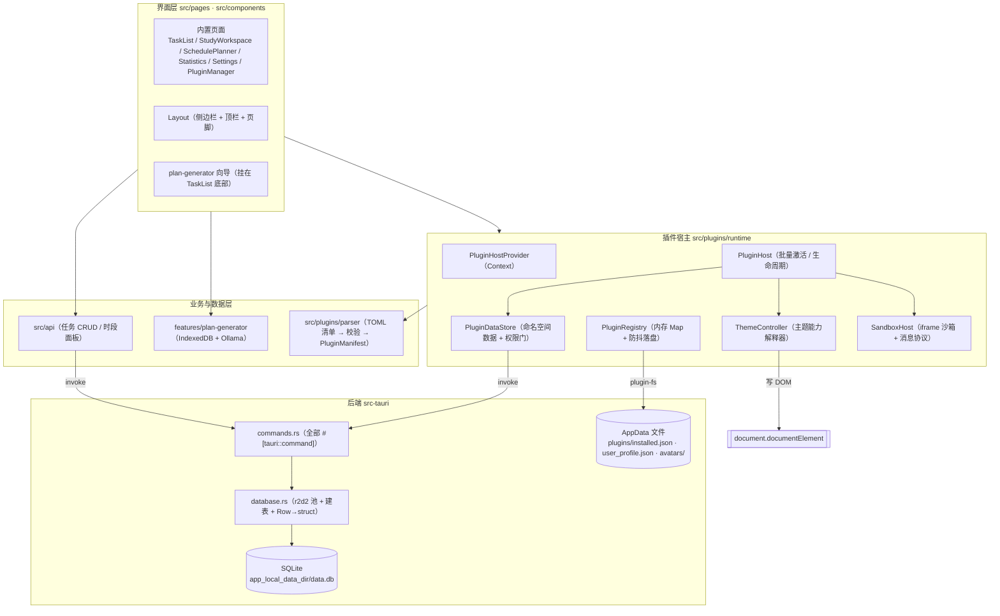

# 架构总览

面向"要改代码的人"：先看这张图，再按需跳到对应章节。

## 1. 分层



要点：
- **界面层从不直接碰 SQLite**。所有落库都经过 `src/api/*.ts` 或 `PluginDataStore` 的 `invoke` 调用。
- **插件宿主是一个独立的运行时**，它只依赖 `parser` 与浏览器 API；主应用通过 Context 消费它。
- **`ThemeController` 是唯一写 `<html>` 主题痕迹的地方**，主应用不含任何 `dark` 判断逻辑（除了
  Tailwind 的 `dark:` 类，它们由 `<html class="dark">` 驱动）。

## 2. 启动时序

```
main.tsx
 └─ <App>
     └─ PluginHostProvider                 ← 插件宿主在此创建，仅创建一次（useRef 守卫）
         ├─ 同步：new PluginRegistry() / new PluginHost()
         │   ├─ registry.loadSync()        ← 从 localStorage 镜像恢复，保证首帧主题不闪白
         │   └─ host.scheduleActivation()  ← 放进 requestIdleCallback，不阻塞首屏
         ├─ useEffect：host.init()
         │   ├─ registry.init()            ← Tauri 下读 AppData/plugins/installed.json 覆盖镜像
         │   ├─ dataStore.purgeExpired()   ← 清理已过保留期的插件数据（墓碑）
         │   └─ startPurgeTimer()          ← 每 6 小时再清一次
         └─ 渲染 <AppRoutes>
             └─ usePluginRoutes()          ← 把启用的 page 能力插件转成 <Route> 元素数组
```

`ready` 标志（`usePluginHost().ready`）表示异步存储已对齐，UI 可据此显示加载态。

## 3. 插件宿主内部机制

五个类，职责严格分离。**改插件系统前请先读完这一节。**

| 模块 | 文件 | 职责 | 关键约束 |
|---|---|---|---|
| `PluginRegistry` | `runtime/registry.ts` | 已安装插件的内存 Map + 顺序数组；持久化（150ms 防抖） | `snapshot()` 保持**对象引用稳定**，只给被改的插件换新对象，使 `React.memo` 行组件零重渲染 |
| `PluginHost` | `runtime/host.ts` | 把"已启用插件"批量解释为真实效果；管理数据生命周期 | 空闲调度激活；单个插件异常被 try/catch 隔离，绝不外抛 |
| `ThemeController` | `runtime/capabilities.ts` | 主题能力解释器：写 CSS 类 / data 属性 / CSS 变量 / 注入 `<style>` | 幂等（同一 `(pluginId, cap 引用)` 直接返回）；切换时**先精确撤销上一轮痕迹**再写入 |
| `PluginDataStore` | `runtime/dataStore.ts` | 按 `namespace` 隔离的 KV 数据 + 卸载保留期（墓碑） | 权限在 **store 内部**强制校验，与调用方无关；越权一律抛错，不静默放行 |
| `SandboxHost` | `runtime/sandbox.ts` | 在 `sandbox="allow-scripts"` 的隐藏 iframe 里跑插件 JS，用 postMessage 回传 | `event.source` 必须等于该插件 iframe 的 `contentWindow`；内联插件另有一次性 token 校验；无 `allow-same-origin`，插件**无法**访问主应用 DOM/storage |

### 激活流程（`PluginHost.activateAll()`）

1. 停用「已卸载 / 已禁用」的插件（`deactivate` → 撤销主题、卸载 iframe）。
2. 按**安装顺序**激活启用的插件，每个包一层 try/catch；失败计入 `metrics.failed`。
3. 重建主题状态：以**安装顺序靠后的主题插件**为准；若存在启用的 `code.kind = 'theme'` 插件，
   则声明式主题让位（避免两个主题互相打架）。
4. `finally` 里更新 `metrics` 并 `emit()` 通知订阅者（Context 借此刷新）。

`flush()` 会取消待处理调度并**立即激活**——用户主动开关插件时调用，保证即时可见。

### 数据保留期（墓碑机制）

```
卸载（有 data 能力）
  └─ dataStore.tombstone(id, retentionDays, name, namespace)   ← 数据不动，只记墓碑
      ├─ 保留期内重新安装 → dataStore.restore(id)              ← 数据自动恢复可见
      └─ 到期 / 回收站"立即清除" → clearNamespace(namespace)   ← 按命名空间删干净
```

默认保留 **3 天**，清单可声明 0–90 天。墓碑与清理逻辑都在 `dataStore.ts`，
UI 入口是 `components/plugins/TrashPanel.tsx`。

## 4. 路由与导航装配

- 内置路由在 `src/App.tsx` 硬编码：`/tasks`、`/schedule`、`/stats`、`/settings`、`/plugins`。
- 插件页面由 `usePluginRoutes()` 生成。**它必须返回 `<Route>` 元素数组并直接在 `<Routes>` 内
  展开**——React Router 7 只接受 `<Route>`/`Fragment` 作为 `<Routes>` 的直接子元素，
  包装成自定义组件会直接抛 `is not a <Route> component`。
- 导航项在 `Layout.tsx` 合并：核心导航优先，插件页路径若与核心冲突则跳过；同 `pageId`
  冲突时**先启用者生效**（按安装顺序取第一个）。
- 图标走白名单：清单只能声明 `smile|calendar|tasks|chart|plug|settings|home|moon`，
  未命中回退到插件图标。

## 5. 目录职责速查

### `src/`

| 路径 | 职责 |
|---|---|
| `api/index.ts` | **任务**的全部 CRUD（`invoke` 封装 + JSON 字段的序列化/反序列化）；心情数据不在这里，见 `plugins/pages/moodData.ts` |
| `api/scheduleStore.ts` | 时段面板的独立数据域，命名空间 `__schedule`，按天存（collection = 日期） |
| `api/studyStore.ts` | 学习工作区的独立数据域，命名空间 `__study`（`sessions` / `notes` / `progress` / `tutor`）；随备份导出并在报告里单独计数 |
| `components/Layout.tsx` | 侧边栏 / 顶栏 / 页脚；合并核心导航与插件导航 |
| `components/tasks/` | `TaskCard` 完整卡片、`TaskCompactRow` 紧凑行（含**行上状态徽标**：点击 暂缓→进行中→完成）、`TaskHoverCard` 悬浮详情卡（portal + 视口定位）、`taskDetails.ts` 展示层解析（详情与来源分离、状态循环、日期可读化）、`TaskFilter` 筛选排序、`TaskForm` 表单（状态不在表单里改） |
| `features/study/components/` | `StudyFocusCard`（聚焦一条任务）、`ReadingView`（阅读优先的正文视图：Markdown 还原 + 专注阅读）、`MarkdownText`（Markdown 子集 → React 元素，不走 innerHTML）、`TutorPanel`（辅导员对话）、`PomodoroCard`、`StudyNotesCard`、`StudyReviewCard` |
| `features/study`（纯函数） | `pomodoro` 状态机、`reading` 白名单闸门、`markdown` Markdown 子集解析、`planLink` 任务↔资源还原、`review` 间隔复习、`tutor` 先检索再回答、`sessionMemory` 回流记忆 |
| `components/mood/` | `MoodCalendar` 月历、`MoodEntryForm` 打分录入 |
| `components/plugins/` | 安装弹窗、详情弹窗、卸载确认、回收站、列表行 |
| `pages/` | 5 个内置页面，见下表 |
| `plugins/parser/` | TOML → `PluginManifest`：`parser.ts`（流程）、`validator.ts`（zod schema + 业务校验）、`types.ts` |
| `plugins/runtime/` | 插件宿主（见第 3 节）；`index.ts` 统一出口 |
| `plugins/builtin/` | 3 个内置插件清单（`.toml`，经 `?raw` 内联）+ 一键（重）安装入口（版本比较已上移到 `utils/version.ts`） |
| `plugins/pages/` | **受信任的页面组件**，由 `runtime/pages.tsx` 的注册表懒加载 |
| `features/plan-generator/` | 计划生成器子域，自带 README；详见 `features/plan-generator/README.md` |
| `features/backup/` | 全量数据导出/导入：`backupService.ts`（聚合 → 校验 → 合并恢复）+ `components/DataBackupCard.tsx`（设置页入口）；Rust 侧配合 `plugin_data_dump` |
| `hooks/` | `useUserProfileTauri`、`useTheme`（委托插件主题）、`useWindowedList`（窗口化列表） |
| `utils/` | `timeSlots.ts`（时段换算）、`version.ts`（唯一的 `compareVersions`）、`runtime.ts`（`isTauriRuntime`）、`openExternal.ts`（外链跳转）、`appSettings.ts`（应用偏好持久化）、`download.ts`（下载/剪贴板） |
| `types/index.ts` | 主应用的领域模型：`Task`、`Mood`、`HabitPeriod`、`HabitCompletion` 等 |

### `pages/` 五个页面

| 页面 | 路由 | 职责与注意点 |
|---|---|---|
| `TaskList.tsx` | `/tasks` | 进行中 / 历史双视图；普通任务完成播"撕便签"动画后入历史，习惯任务原地按日打卡；筛选 all/pending/completed/habits/today 与 5 种排序；**计划任务按队列只放行一条**（完成一条才出现下一条，见 `features/plan-generator/services/planQueue.ts`）；**悬浮行浮现详情卡**；行上徽标点击切换状态；底部嵌入 `PlanGeneratorWorkspace` |
| `StudyWorkspace.tsx` | `/study` | **执行计划**的地方：聚焦"下一条待做"（复用 `planQueue` 语义）→ 白名单阅读模式 → 番茄钟计时 → 收工写会话与记忆 → 间隔复习（1/3/7/16 天）；侧栏为计时/复习/速记；数据落在 `__study` 命名空间，随备份导出（见 `docs/STUDY-WORKSPACE.md`） |
| `SchedulePlanner.tsx` | `/schedule` | 周视图 6 时段 × 7 天 = 42 格；数据与任务表**完全解耦**；时间拖动按 5 分钟吸附 |
| `Statistics.tsx` | `/stats` | 本周/月/年切换**真实生效**（窗口 7/30/365 天，趋势与上一等长周期对比）；心情数据经 `dataStore.list('core','mood','entries')` 读取，**仅当 `mood-diary` 插件启用时**才有数据，否则降级为空 |
| `Settings.tsx` | `/settings` | 主题由插件托管（`THEME_PLUGIN_IDS = ['dark-theme','wireframe']`，同时只允许一个生效）；应用偏好走 `utils/appSettings.ts` 持久化；含个人画像、资源联网、数据备份三张卡片 |
| `PluginManager.tsx` | `/plugins` | 安装（文件 / URL / 内置一键）、启停、卸载、回收站、激活指标；搜索用 `useDeferredValue`，条目 > 60 时启用 `useWindowedList` |

### `src-tauri/src/`

| 文件 | 职责 |
|---|---|
| `lib.rs` | **应用唯一入口**：把数据库初始化到 `AppState`、挂载 `fs` / `opener` 插件、注册全部 11 个命令、`pub fn run()` |
| `main.rs` | 4 行薄封装：`fn main() { mood_task_app::run() }`（release 下隐藏控制台窗口） |
| `commands.rs` | 所有 `#[tauri::command]`（11 个）：任务 CRUD + 增量 `patch_task`、插件命名空间数据读写与全量导出 |
| `database.rs` | 连接池（r2d2 + rusqlite bundled）、建表与索引、`user_version` 顺序迁移、`Row → Task` 映射 |

## 6. 关键设计决策

| 决策 | 理由 |
|---|---|
| 插件采用**声明式能力**而非可执行代码 | 插件清单不携带代码 ⇒ 天然安全、可审计；解释开销极低，适合大量插件同时启用 |
| 仍保留 `code` 能力，但强制沙箱 | 给"去中心化自由开发"留口子：插件可写任意 JS 生成主题，但运行在 opaque-origin iframe，只能走受限消息协议 |
| 激活放在 `requestIdleCallback` | 启动时不因插件数量拖慢首屏；同帧多次注册表变更合并为一次批量激活 |
| `loadSync()` 先读 localStorage 镜像 | 首帧即可拿到主题状态，避免"先浅色再变深色"的闪烁；Tauri 文件为异步真源，读到后回写镜像 |
| 注册表快照保持对象引用稳定 | 插件列表用 `React.memo` 行组件；引用稳定 ⇒ 无关变更时零重渲染 |
| 数据按 `namespace` 隔离 + 卸载保留期 | 插件被卸载不等于数据被删；保留期内重装自动恢复，避免误操作导致用户数据丢失 |
| 删除任务用"撕便签"动画后再落库 | 让删除可感知；动画期间行保留在列表中，避免列表瞬间跳变 |
| 更新任务走**增量** `patch_task` 而非全量覆盖 | 去掉"读-改-写"，未提供的字段不会被覆盖；列名查白名单、值走占位符，从结构上排除注入 |
| 数据库变更走 `PRAGMA user_version` 顺序迁移 | 加字段不再需要删库重建（原本会丢用户数据）；迁移条目只追加，`guard` 兼容新库已含该列 |
| 桌面端路由用 `HashRouter` | 打包后 WebView 走 Tauri 自定义协议，Browser 式路径在刷新/深链（如直接进 `/plugins`）时会 404 |
| 外链统一走 `openExternal()` | WebView 内 `target="_blank"` 打不开系统浏览器；统一收口还能顺带只放行 http(s) |
| 备份采用"合并 / 覆盖"而非清库重建 | 误导入不会造成不可逆丢失：任务按 `标题+创建时间` 去重追加，同 key 覆盖 |

## 7. 性能设计一览

| 位置 | 手段 |
|---|---|
| 插件列表（>60 项） | `useWindowedList`（`itemHeight: 232`, `threshold: 60`），滚动经 rAF 节流 |
| 插件注册表写盘 | `persist()` 150ms 防抖，批量操作只落盘一次 |
| TOML 解析 | `context.tsx` 的 `parseToml` 放进空闲回调（`timeout: 500`），大清单不卡 UI |
| 数据清理 | 每 6 小时一次 `purgeExpired`，而非每次访问都算 |
| LLM 调用 | `llmTaskManager` 串行 + 单 key 去重 + 空闲调度 + 离开向导 `cancelAll`；Ollama 带 `keep_alive: '30s'` |
| 页面组件 | `runtime/pages.tsx` 全部 `lazy()` 懒加载，不进首屏包体 |
